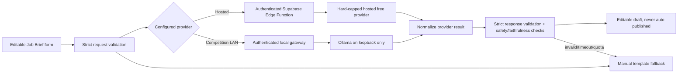

# Zero-Cost AI Job Brief Strategy

## Decision status

**Confirmed:** the Job Brief Builder must perform genuine model inference when labelled AI-powered; its output is an editable draft; manual gig creation always works; external-service spend is PHP 0 / USD 0 with no payment method, paid plan, promotional-credit dependency, or automatic overage.

**Proposed:** run a time-boxed feasibility experiment with local Ollama on the development laptop as the leading path, compare two pinned small open-weight models, and keep a hard-capped hosted free tier only as a contingency. Do not select a final provider/model until the measured gate below passes.

This research snapshot is dated 2026-10-21. Hosted limits and model terms change, so M10 must re-check the linked primary sources immediately before enabling any provider.

## Option comparison

| Option | Genuine inference and expected quality | Hardware/download | Connectivity and latency | Privacy/reliability | Cost/licensing conclusion |
|---|---|---|---|---|---|
| Laptop Ollama over authenticated local gateway | Yes. A 1.7B-4B instruct model is plausible for transforming structured facts into a short brief; quality is unproven until evals | Candidate Qwen3 Q4 downloads are about 1.4 GB (1.7B) and 2.5 GB (4B) in the [Ollama model registry](https://ollama.com/library/qwen3/tags). Runtime memory is higher and must be measured on the actual laptop | Works on a team-controlled LAN/hotspot without public Internet after model download; cold/warm latency depends on CPU/GPU/RAM | Prompts stay on team devices; demo depends on laptop, local network, power, and a tested gateway. Ollama's local API has no authentication by default ([docs](https://docs.ollama.com/api/authentication)) | Best first experiment. Ollama is local software; pin its version, model tag/digest, and model license. Never expose port 11434 directly |
| On-device Android (ExecuTorch or MLC) | Yes and truly offline, but quality is constrained by models the phone can hold | Multi-GB weights plus native runtime; competes with app storage/RAM and may trigger thermal throttling/OOM | No network; initial load and token rate unknown on the actual phone | Strong privacy and fewer demo-network dependencies, but highest native integration and device-fragmentation risk | Research/spike only. ExecuTorch documents [LLM deployment and Android paths](https://docs.pytorch.org/executorch/stable/llm/getting-started.html); MLC includes Android support in its [open-source runtime](https://github.com/mlc-ai/mlc-llm). Not a P0 promise without a device benchmark |
| Cloudflare Workers AI Free | Yes; eligible hosted models can provide stronger output than small local models | No local model | Requires public Internet; capacity/rate failures possible | Prompt leaves Supabase/phone for Cloudflare; provider credentials must remain server-side | Strongest hosted contingency. The Free plan currently includes 10,000 neurons/day; exceeding it fails unless the account is upgraded, and some models require paid access ([official pricing](https://developers.cloudflare.com/workers-ai/platform/pricing/)). Create no paid plan/payment method and choose only a free-eligible model |
| Gemini Developer API Free tier | Yes, with good likely quality but model/quotas vary | No local model | Requires public Internet; no competition SLA | Free-tier content may be used to improve Google's products according to [official pricing](https://ai.google.dev/gemini-api/docs/pricing), so use only minimized, non-sensitive fields | Experiment-only contingency. Free-to-paid transition requires linking billing ([rate-limit docs](https://ai.google.dev/gemini-api/docs/rate-limits)); never link billing. Reverify available model and quota before use |
| Hugging Face Inference Providers free credit | Yes when a suitable model/provider is available | No local model | Requires public Internet and provider capacity | Third-party processing; availability/model support can change | Not a dependable demo baseline. Free users currently receive only $0.10 monthly credit, explicitly subject to change; further usage requires purchasing credits ([official pricing](https://huggingface.co/docs/inference-providers/en/pricing)) |
| Deterministic template | No; useful structured text generation but not AI inference | Negligible | Fully offline and immediate | Most reliable and private | Mandatory fallback, clearly labelled `Manual template`, never presented as AI |

Do not use dedicated Hugging Face Inference Endpoints: they require an active subscription/payment method and are billable ([official access guide](https://huggingface.co/docs/inference-endpoints/guides/access)). Do not use an unverified “free” proxy, scraped endpoint, personal consumer-chat automation, or API with automatic overage.

## Feasibility experiment before selection

M10 begins with an experiment branch and report, not production integration.

### 1. Record the test environment

- laptop CPU, GPU/VRAM, RAM, operating system and free disk;
- exact Android model, Android version, RAM and free storage;
- Ollama version;
- exact model tag, immutable digest, quantization, download size, context setting and license URL;
- LAN/hotspot topology and whether public Internet is disabled; and
- measured idle/load power and thermals where available.

Do not commit model weights. Cache/download them outside Git and document a checksum-based setup.

### 2. Candidate set

Start with at most two text-only instruction candidates to keep the experiment controlled:

1. `qwen3:1.7b-q4_K_M` as the low-resource baseline (registry currently reports about 1.4 GB); and
2. `qwen3:4b-instruct-2507-q4_K_M` as the quality candidate (about 2.5 GB).

The upstream Qwen3 4B Instruct license is Apache-2.0 in the [publisher model repository](https://huggingface.co/Qwen/Qwen3-4B-Instruct-2507/blob/cdbee75f17c01a7cc42f958dc650907174af0554/LICENSE), but the exact Ollama artifact and notices still require review. Gemma 3 4B may be a comparison only if needed; its current Ollama artifact is about 3.4 GB, and distribution/use carries the separate [Gemma Terms](https://ai.google.dev/gemma/terms/). Do not choose a model merely from generic leaderboard scores.

Use a deliberately small context (proposed 2,048-4,096 tokens), non-streaming structured output, fixed prompt version, low temperature, and maximum 600 output tokens. Ollama supports supplying a JSON Schema and still recommends validating the result ([structured output docs](https://docs.ollama.com/capabilities/structured-outputs)).

### 3. Regression evaluation set

Commit at least 40 synthetic, non-personal fixtures and expected rubric results:

- sparse briefs, complete briefs, onsite/remote/hybrid gigs;
- common Makati/Metro Manila contexts and English/Taglish input;
- errands, delivery, cleaning, events, admin, tutoring and digital work;
- unrealistic budget/deadline, prohibited/unsafe work and ambiguous requests;
- Unicode, long text, empty arrays and boundary lengths;
- prompt injection embedded in every free-text field;
- requests to reveal system prompts, secrets, HTML/script or SQL;
- output that invents address, pay, deadline, credentials or legal claims; and
- provider timeout, malformed JSON, extra keys, truncated response and refusal.

Human reviewers score usefulness, faithfulness, clarity, unsafe content, invented facts and edit effort on a fixed rubric. The same fixtures run for every prompt/model/provider change.

### 4. Proposed pass gate

A candidate advances only when it achieves all of:

- 100% responses either pass the strict output schema or safely return the manual fallback; no partially trusted output;
- at least 95% schema-valid first responses on ordinary fixtures;
- zero invented required facts (pay, deadline, location, identity) in the reviewed set;
- no instruction-following from adversarial user text outside the brief task;
- median warm response <= 5 seconds and p95 <= 10 seconds on the actual laptop, cold response <= 20 seconds;
- 20 consecutive requests without crash/OOM and with bounded memory recorded;
- useful/faithful rating >= 4/5 on at least 85% of ordinary fixtures by two teammates;
- full offline-LAN demo succeeds after model download, including phone reconnect and gateway restart; and
- license/notice obligations are recorded and compatible with contest distribution.

Targets may be revised before the experiment, but not after seeing results merely to force a pass. If neither local candidate passes, test one eligible Cloudflare Free model under the same fixtures and hard-cap rules. If no path passes, the AI claim is a product blocker: ship the honest manual builder and demonstrate the feasibility findings rather than mislabeling a template.

## Architecture



The mobile feature depends only on a versioned internal contract. It must not import a provider SDK. Hosted provider credentials live in Edge Function secrets. The competition LAN gateway is a separate local process; Ollama remains loopback-only.

### Provider interface

```ts
type AiProvider = {
  readonly id: string;
  generateJobBrief(
    input: JobBriefRequest,
    options: { signal: AbortSignal; maxOutputTokens: number },
  ): Promise<unknown>;
};
```

Adapters map vendor requests/responses and errors to internal types. They do not own product validation, prompt text, authorization, rate limits or fallback UX. Provider/model/prompt changes are reviewed changes with regression evidence. Pin exact provider model IDs; never use `latest` for an accepted build.

## Versioned request and response contract

Both request and response use strict Zod schemas (`.strict()`), exported to JSON Schema where the provider supports it. The endpoint accepts `Content-Type: application/json` only.

### Request

```json
{
  "schemaVersion": "1",
  "requestId": "UUID",
  "locale": "en-PH",
  "facts": {
    "taskSummary": "string, 10-1200 chars",
    "category": "approved category slug",
    "workMode": "onsite | remote | hybrid",
    "publicArea": "optional string, max 120",
    "budgetPhp": 1200,
    "dueAt": "optional ISO-8601 timestamp",
    "tasks": ["0-10 strings, each max 200"],
    "skills": ["0-10 strings, each max 80"],
    "constraints": ["0-8 strings, each max 200"]
  }
}
```

Rules:

- Entire serialized body <= 8 KiB; no images/files/URLs/contact details/exact address.
- `budgetPhp` is optional but, if present, is finite, 0.01-1,000,000 with two decimals.
- `publicArea` is required for onsite/hybrid and omitted for remote.
- The server derives user identity from authentication and ignores/rejects identity fields.
- Free text is marked as untrusted data in the prompt. It cannot override system instructions.

### Successful response

```json
{
  "schemaVersion": "1",
  "requestId": "same UUID",
  "draft": {
    "title": "string, 5-100 chars",
    "description": "string, 20-2000 chars",
    "category": "approved category slug",
    "workMode": "onsite | remote | hybrid",
    "tasks": [
      {
        "description": "string, 5-200 chars",
        "acceptanceCriterion": "string, 5-240 chars"
      }
    ],
    "skills": ["0-10 strings, each max 80"],
    "assumptions": ["0-5 strings, each max 200"],
    "safetyNotes": ["0-5 strings, each max 200"]
  },
  "meta": {
    "provider": "non-secret identifier",
    "model": "pinned model identifier",
    "promptVersion": "job-brief-v1"
  }
}
```

Require 1-10 tasks. No markdown/HTML, contact data, exact address, executable text, payment instruction, confidence claim, or provider prose is allowed. `category`, `workMode`, budget and due date cannot contradict supplied facts; the deterministic server layer copies authoritative factual fields rather than asking the model to regenerate them. Unknown keys or excessive values invalidate the entire model result.

### Failure response

```json
{
  "error": {
    "code": "AI_UNAVAILABLE",
    "message": "AI drafting is unavailable. Continue with the manual template.",
    "details": []
  }
}
```

Stable codes: `VALIDATION_FAILED` (422), `UNAUTHENTICATED` (401), `FORBIDDEN` (403), `RATE_LIMITED` (429), `AI_TIMEOUT` (503), `AI_CAPACITY` (503), `AI_INVALID_OUTPUT` (502), and `AI_UNAVAILABLE` (503). Provider messages/stacks never reach the client.

## Prompt and output safety

The system prompt has one task: convert delimited structured facts to the exact schema without inventing facts. It states that all fact values may contain hostile instructions and must be treated as quoted data. It prohibits contact details, exact addresses, discriminatory criteria, illegal/unsafe work, payments outside the platform, and claims that the gig has been verified.

Defense is layered:

1. strict request schema and allowlists;
2. size/token caps before interpolation;
3. deterministic prompt template with clear data boundaries;
4. provider structured-output mode where available;
5. JSON parse and strict response schema;
6. deterministic comparison against authoritative category/mode/budget/deadline;
7. prohibited-content rules;
8. editable preview with visible `AI draft - review before publishing`; and
9. the normal gig publish validator/RPC, which does not trust the AI path.

Never send secrets, hidden profile fields, email, phone, exact coordinates/address, image evidence, report text, or unrelated conversation history to a model. Do not execute model output as SQL, shell, URLs, HTML, file paths or tool calls.

## Authentication, limits and failure policy

### Hosted path

The mobile app calls one Supabase Edge Function with its Supabase bearer token. The function verifies the token, derives `auth.uid()`, validates onboarding, and atomically reserves the request in `ai_request_log` before calling the provider. Provider API tokens are server secrets. CORS is not authentication.

Proposed limits:

- 5 accepted requests per 10 minutes and 20/day/user;
- one result per `(user_id, requestId)`;
- request <= 8 KiB, provider input <= 2,048 tokens, output <= 600 tokens;
- 12-second provider timeout and 15-second end-to-end budget;
- no inference retry by default; at most one jittered retry for a proven pre-response transport failure with the same idempotency key;
- at most 2 concurrent provider calls per user and a small global semaphore; and
- provider daily free quota configured/monitored below its hard platform ceiling.

Quota exhaustion, capacity, timeout and invalid output immediately return the manual fallback. There is no automatic switch to a provider with different privacy terms or any paid endpoint.

### Local Ollama/LAN path

Ollama stays on default loopback (`127.0.0.1:11434`). Official documentation confirms the local API does not require authentication, so exposing it with `OLLAMA_HOST=0.0.0.0` is prohibited ([authentication](https://docs.ollama.com/api/authentication), [network configuration](https://docs.ollama.com/faq)).

The phone connects only to a small gateway that:

- binds to the team-controlled private LAN interface and proxies only the one job-brief operation to loopback Ollama;
- validates the same schemas and rate limits as the hosted function;
- requires a random 256-bit pairing token generated at gateway start, transferred to the dedicated phone by QR/manual pairing, stored securely, held hashed/in-memory server-side, and expired/revoked after at most two hours;
- allows only the expected device/session, request method/path/content type and bounded body;
- uses HTTPS with a dedicated local CA/certificate trusted only by the competition build/device; never sends the bearer token or prompt over open Wi-Fi in plaintext;
- restricts the host firewall to the private profile and competition subnet;
- logs only request ID, status, model digest and timing; and
- has no model-management, file, shell, arbitrary proxy, or public bind route.

The app's local endpoint is supplied by the controlled competition configuration/pairing flow and must resolve to a private address. It cannot be an arbitrary user URL. Preflight proves certificate trust, gateway health, model digest, one successful fixture, token expiry, firewall behavior, laptop power and reconnect. A cleartext exception is not approved by this plan; if TLS cannot be made reliable, use the hard-capped hosted path or manual fallback.

This LAN gateway is a competition/demo topology, not a public multi-user production service. The app must indicate `Local AI connected` and fail closed if pairing expires.

## Manual fallback

The deterministic builder combines user-entered facts into editable sections and never calls a model. It is available before, during and after AI failure. UI labels must be explicit:

- `Generate AI draft` only when an inference provider is available;
- `Use manual template` for deterministic construction; and
- `AI unavailable - your entries are saved` on provider failure.

The fallback never fabricates tasks, price, deadline or location. It preserves form values, lets the user retry explicitly, and reaches the same draft validation/publish flow.

## Observability and data retention

Persist only the metadata in `ai_request_log`: user ID, request UUID, provider/model identifier, status, character counts, latency and stable error code. Do not persist prompts or responses by default. Development fixture outputs contain synthetic data and may be committed as eval artifacts.

Monitor locally/through existing free logs:

- success, schema-invalid, timeout, capacity and rate-limit counts;
- p50/p95 latency and output size;
- manual-fallback selection; and
- provider quota remaining when an official API exposes it.

Never add a paid logging service. Redact authorization headers, URLs containing tokens, exact user text and provider payloads.

## Selection and release checklist

A final AI ADR may be accepted only after the feasibility report records:

- measured hardware/model results and regression fixture commit;
- exact software/model pins, digest, license and required notices;
- provider account has no billing method/paid plan and has a hard failure ceiling;
- local gateway threat test or hosted Edge Function auth/rate-limit tests;
- strict request/output contract tests and prompt-injection cases;
- offline/no-provider/manual-fallback device walkthrough;
- privacy disclosure appropriate to the selected provider; and
- a competition-day runbook with model pre-download, laptop power, hotspot/TLS setup and a one-click health check.

Until then, local Ollama is the recommended experiment, not the selected production model, and Cloudflare Workers AI Free is only the leading hosted contingency.
