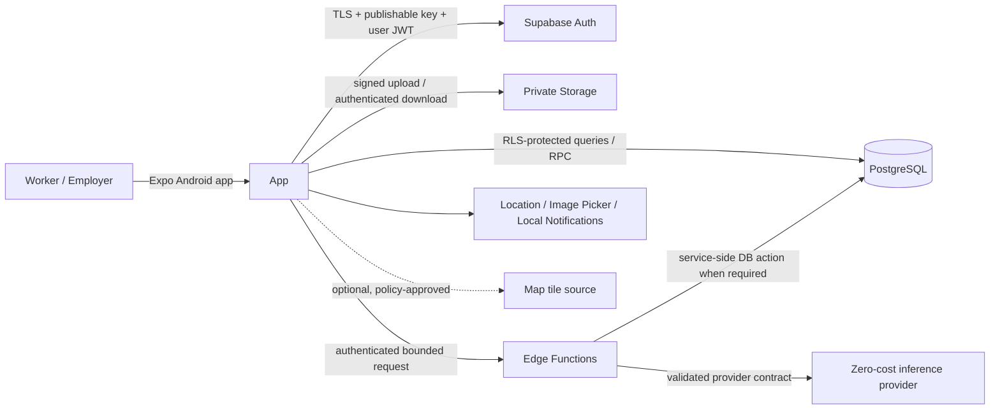
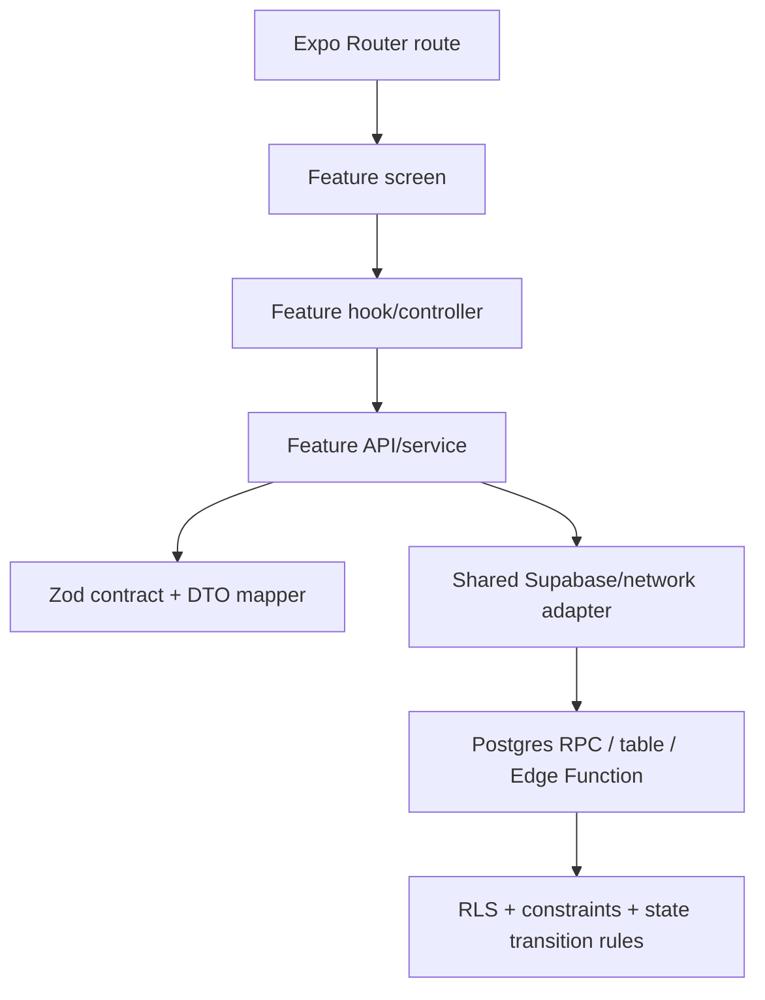
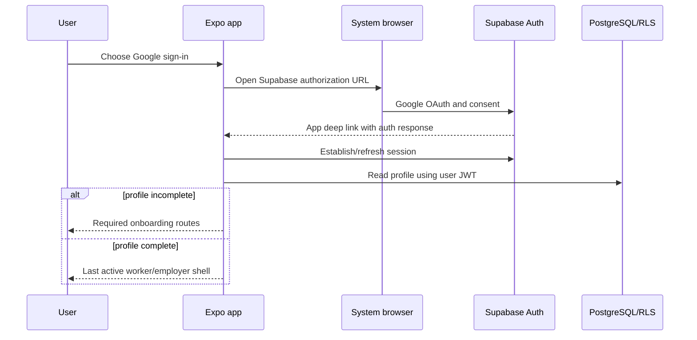
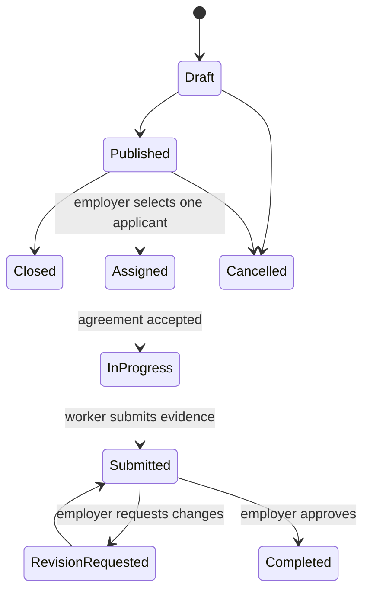

# Application Architecture

## Status and design goal

**Status:** implemented Expo/Supabase modular monolith, with ongoing hosted/device acceptance in [#46](https://github.com/DanielHC16/do-well/issues/46). Current repair integration is [PR #48](https://github.com/DanielHC16/do-well/pull/48); consult the session handoff and demo guide for verified test/build results. Optional integrations below remain design contracts unless their implementation/evidence is explicitly recorded.

The architecture is an Android-first **modular monolith**: one Expo application, one Supabase project, PostgreSQL/RLS as the authorization boundary, private Storage for evidence, and a small number of Edge Functions only where client-direct access is unsafe. It optimizes for a student team, a reliable competition demonstration, and six months of development—not hypothetical scale.

## Confirmed constraints and proposed choices

| Area | Confirmed | Proposed implementation |
|---|---|---|
| Client | React Native, TypeScript, Expo development builds, Expo Router | Strict TypeScript; route files stay thin and delegate to feature modules |
| Backend | Supabase Auth, PostgreSQL, RLS, Storage, Edge Functions where justified | Direct RLS-protected reads/simple writes; SQL RPC for transactional state changes; Edge Functions for AI and privileged side effects |
| Auth | Google browser OAuth and email/password; one account, two modes | Supabase browser flow, app scheme callback, and the SDK-supported React Native session adapter verified in M03 |
| Server state | Reliable loading/error/retry behavior | Scoped TanStack Query owns repaired account capability/admin requests and moderation invalidation; older marketplace features retain their existing gateway/effect/cache lifecycle pending separate migration |
| Local state | Keep dependencies minimal | Component state for forms; a small Context for current user/active mode/connectivity; no general store initially |
| Validation | Validate every external input and model output | Zod schemas shared by forms, query mapping, and Edge Function contracts; database constraints remain authoritative |
| Persistence | Weak-connectivity support | Supabase-documented React Native storage for sessions (AsyncStorage baseline); ordinary AsyncStorage for non-sensitive cache metadata/drafts; SecureStore only after token-size/platform validation; file system only for temporary upload staging |
| Maps | No paid Google Maps dependency | Distance-sorted list is P0; MapLibre/map tiles are optional behind an adapter only after policy and device feasibility pass |
| Brief assistance | Zero paid services and honest provider status | Default deterministic local template; optional provider adapter is not configured in the default singleton, so model inference is not claimed |
| Notifications | Android-native behavior | Local notifications first; remote push only if separately approved and verified free |

## System context



Trust boundaries:

- The mobile client and its public configuration are untrusted. UI visibility never grants authorization.
- The user JWT plus RLS determines row access. Privileged keys exist only in managed server secrets and local operator tooling.
- AI/model output is untrusted data and cannot directly publish a gig, form SQL, choose paths/URLs, or trigger shell/tool execution.
- Map/tile and AI providers are optional dependencies; core manual/list flows remain available without them.

## Proposed repository structure

```text
app/                              # Expo Router only: composition and navigation
  _layout.tsx                     # providers, session gate, error boundary
  +not-found.tsx
  (public)/
    _layout.tsx
    index.tsx                       # welcome / anonymous landing
    sign-in.tsx
    sign-up.tsx
    auth/
      callback.tsx                 # resolves dowell://auth/callback
      reset-password.tsx           # resolves dowell://auth/reset-password
  (onboarding)/
    _layout.tsx
    profile.tsx
    worker-preferences.tsx
    location.tsx
  (app)/
    _layout.tsx                   # authenticated shell and active-mode navigation
    worker/
      _layout.tsx
      index.tsx                   # discovery list
      gigs/[gigId].tsx
      applications/index.tsx
      assignments/[assignmentId].tsx
    employer/
      _layout.tsx
      index.tsx                   # employer dashboard
      gigs/new.tsx
      gigs/[gigId]/index.tsx
      gigs/[gigId]/edit.tsx
      gigs/[gigId]/applicants.tsx
      assignments/[assignmentId].tsx
    activity.tsx
    profile.tsx
    settings.tsx
    modal/
      ai-brief.tsx
      image-evidence.tsx

src/
  features/
    auth/                          # session/onboarding UI, schemas, service
    profile/
    gigs/
    discovery/
    applications/
    assignments/
    submissions/
    activity/
    ai-brief/
    location/
    notifications/
    reports/
  shared/
    api/                           # Supabase client, RPC wrappers, query keys
    config/                        # validated public runtime config
    errors/                        # typed app errors and safe message mapping
    persistence/                   # session and AsyncStorage adapters
    ui/                            # reusable accessible primitives/tokens
    validation/                    # cross-feature schemas only
    observability/                 # redacted structured logging
    test/                          # render helpers, fixtures, mock server/client
  types/
    database.generated.ts          # generated; never hand-edited

supabase/
  config.toml
  migrations/                      # schema, functions, RLS, indexes
  functions/
    ai-job-brief/
      index.ts
      contract.ts
      providers/
    _shared/                       # auth, CORS, error, rate-limit helpers
  tests/                           # SQL/RLS tests and fixtures

tests/                             # cross-feature integration tests
e2e/                               # critical Android flows
docs/                              # durable design, ADRs, roadmap, handoff
```

Route groups express navigation, not security. Dynamic identifiers are validated before use. Files under `app/` import feature screens/controllers; they do not contain Supabase queries or business rules.

## Feature boundaries and dependency rules

Each feature owns its UI, hooks, schemas, query keys, DTO mapping, and tests. A typical feature is:

```text
src/features/gigs/
  components/
  screens/
  hooks/
  api.ts
  schemas.ts
  types.ts
  mappers.ts
  __tests__/
```

Dependencies flow in one direction:



- Features may use `src/shared/*`; shared code cannot import a feature.
- Cross-feature workflows call an explicit service/RPC rather than writing another feature's tables ad hoc.
- SQL owns invariant enforcement. Client schemas improve UX but do not replace constraints/RLS.
- Multi-row mutations and status transitions use a parameterized PostgreSQL function in one transaction. External side effects occur only after commit and are retry-safe.

## State and data flow

### State ownership

| State | Owner | Persistence |
|---|---|---|
| Input text, selected filters, modal visibility | Component/form hook | None unless a declared draft |
| Account capability/admin remote rows and request status | Scoped TanStack Query ([ADR 0009](adr/0009-scoped-account-server-state.md)) | Memory only; capability/admin data never persisted; new client on account boundary remount |
| Older marketplace remote rows | Existing feature gateways/hooks and bounded cache | Existing user-scoped snapshots and authorization-error rules remain unchanged; broader query migration is separate |
| Auth session | Supabase auth client/session provider | SDK-supported React Native adapter selected and tested in M03; AsyncStorage is the documented baseline |
| Active worker/employer UI mode | `ModeProvider` | AsyncStorage; never used as authorization proof |
| Connectivity | `ConnectivityProvider` backed by `expo-network` and request outcomes | Memory, with event history only in tests/logs |
| Form drafts and pending-action metadata | Feature draft repository | AsyncStorage, versioned and user-scoped |

Do not add Zustand/Redux unless a measured cross-tree state problem remains after Context and query state; record that decision if introduced.

### Networking

- One configured Supabase client is created in `src/shared/api/supabase.ts` after public env validation.
- Query functions return feature DTOs, not raw nullable database rows. Runtime parsing catches contract drift.
- Query keys are factories scoped by user and resource. Sign-out cancels requests and clears user-specific cache/drafts.
- Reads may retry a small bounded number of times with jitter only for transient/network failures. Auth, validation, permission, and conflict errors do not retry automatically.
- Every mutation carries an idempotency key where duplicate creation is possible. Timeout results become “unknown/pending,” followed by server reconciliation rather than blind recreation.
- Uploads validate type/size before obtaining a signed path, show progress, and keep a recoverable local draft on failure.

### API contract pattern

```ts
type ApiResult<T> =
  | { ok: true; data: T; requestId: string }
  | { ok: false; error: { code: string; message: string; retryable: boolean }; requestId: string };
```

This is a proposed app/Edge Function boundary shape, not a database row type. Edge Functions validate request JSON, authenticate the JWT, enforce limits, map internal errors to stable codes, and never return stack traces.

## Validation and error architecture

Validation occurs at every boundary:

1. Forms parse and normalize with feature Zod schemas.
2. API adapters parse response DTOs and reject incomplete/unexpected payloads.
3. Edge Functions parse body, auth context, provider response, and final response.
4. PostgreSQL constraints, foreign keys, RLS, and transition functions enforce durable invariants.

Errors normalize to `validation`, `authentication`, `authorization`, `not_found`, `conflict`, `rate_limited`, `network`, `timeout`, `service_unavailable`, or `unexpected`. UI maps codes to actionable, non-sensitive messages and preserves recoverable input. Structured logs include a request ID, operation, duration, and safe error code—never tokens, secrets, exact private addresses, or full AI prompts.

Global render failures use an app error boundary with restart/report actions. Route-level screens separately handle loading, empty, offline-stale, recoverable error, and forbidden/not-found states.

## Configuration and secrets

- `EXPO_PUBLIC_*` contains only values safe to extract from an APK: the Supabase URL and publishable key plus non-secret feature flags.
- Zod validates public configuration before the application renders; missing or malformed values fail with a safe setup screen in development.
- AI provider credentials, privileged Supabase keys, and rate-limit secrets live only in Edge Function/local server environments. No service-role or `sb_secret_*` value is imported by client code.
- `app.config.ts` reads safe build-time config and declares the stable Android package/scheme only after approval. Environment profiles are explicit (`development`, `preview`, `production`) and never inferred from arbitrary string input.
- Feature flags default to safe/off: interactive map, AI provider, remote push, and background sync.

## Authentication and session lifecycle



The root session provider begins in `restoring`, then becomes `anonymous`, `onboarding`, or `authenticated`. It subscribes once to Supabase auth changes, serializes refresh/storage operations, and unregisters on teardown. Deep-link payloads and redirect origin are validated. Signing out cancels in-flight queries, removes user-scoped non-sensitive drafts/cache, clears session storage through the auth client, and returns to the public route group.

Profile provisioning is idempotent and server-controlled (database trigger or secure RPC; final choice belongs in the authentication/database ADR). Missing profile creation must be safely repairable on sign-in.

## Core workflow state model

Detailed columns and policies belong in the database/security documents. At the application boundary, use explicit finite transitions rather than arbitrary status updates:



Cancellation/dispute semantics and two-party agreement confirmation are still open product decisions. Until resolved, no migration should encode irreversible assumptions about those transitions.

## Offline and weak-connectivity behavior

The architecture names three different capabilities:

1. **Offline-readable cache:** a bounded, user-scoped snapshot of previously fetched discovery/assignment data with stale timestamp.
2. **Offline drafts/pending actions:** versioned local form drafts and explicit pending mutation records, reconciled using idempotency keys.
3. **Background synchronization:** unattended retries subject to Android scheduling constraints; deferred unless M13 proves it necessary and reliable.

P0 guarantees graceful failure, preserved drafts, explicit retry, and duplicate prevention. It does not promise complete offline use or automatic background delivery.

## Testing architecture

- **Unit:** schemas, mappers, distance/recommendation reasons, state reducers, error mapping, draft migrations.
- **Component:** user-visible loading/empty/error/offline/permission states with React Native Testing Library.
- **Contract/integration:** Supabase local stack for migrations, RPC transitions, RLS isolation, Storage policy, and Edge Function contracts.
- **E2E/device:** critical auth-to-completion path in an Expo development build; physical Android permission, deep-link, upload, local notification, process-restart, and weak-network scenarios.
- **AI eval:** fixed safe prompt set, schema validity, latency, unacceptable-content cases, and deterministic fallback labels before changing model/provider/prompt.

Every feature follows red → green → refactor: commit a focused failing behavior test where practical, implement the smallest passing behavior, and run lint/typecheck/targeted tests before the milestone suite.

## Deployment and recovery

- CI verifies format/lint, strict typecheck, tests, migration checks, and a non-secret Expo config/build check on PRs.
- Database changes are versioned migrations: expand, deploy compatible code, migrate/backfill when needed, then contract in a later PR.
- APK/AAB signing material stays outside Git and is handled only after the competition distribution method is confirmed.
- Recovery artifacts include database migrations, a schema-only/approved data export procedure, seed data with no personal data, reproducible app config, and a documented local Supabase path.
- Feature rollback disables optional AI/map/push flags; schema rollback prefers forward corrective migrations over destructive down migrations.

## Decisions that require ADRs

See `docs/DECISIONS.md`. At minimum: modular Supabase architecture, auth/profile provisioning, database/RLS model, map/list strategy, AI provider after benchmark, offline semantics, private evidence storage, and notification strategy. This document summarizes decisions but does not replace those records.
