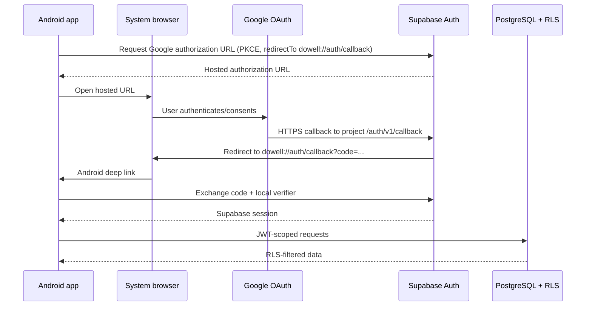

# Authentication Architecture

## Status and chosen flow

The approved identity provider is Supabase Auth with:

- Google hosted/browser OAuth;
- email and password fallback;
- one Supabase user and one application profile for both worker and employer experiences; and
- Android callback `dowell://auth/callback` in Expo development and production builds.

This is an implementation contract, not a claim that Auth is configured. M03 must verify it on a physical Android device. Expo Go is not an acceptance environment because a stable custom scheme requires a rebuilt app ([Expo linking](https://docs.expo.dev/linking/into-your-app/)). Supabase's [native mobile deep-linking guide](https://supabase.com/docs/guides/auth/native-mobile-deep-linking) and [Google provider guide](https://supabase.com/docs/guides/auth/social-login/auth-google?platform=react-native&queryGroups=platform) are the primary setup references.

## Trust boundaries



Google never redirects directly to `dowell://`. Its authorized redirect URI is the Supabase HTTPS callback shown in the Dashboard, normally `https://<project-ref>.supabase.co/auth/v1/callback`. Supabase validates the provider response and then redirects to the allowlisted app URI. Do not add the Google client secret, Supabase secret/service-role key, access token, or refresh token to source control or `EXPO_PUBLIC_*` variables.

## Configuration ownership

### Google Auth Platform console

Configure a **Web application** OAuth client for Supabase's hosted flow:

- authorized redirect URI: the exact Supabase HTTPS callback from the Google provider page;
- audience: External/testing for the competition unless publication is approved;
- test users: every teammate/judge account needed during testing while the app is in testing status;
- scopes: only `openid`, `.../auth/userinfo.email`, and `.../auth/userinfo.profile`;
- branding/support email: team-approved values; and
- no paid Google API or billing account is needed for basic OAuth.

Changing scopes requires a security/product review. Do not request Google Drive, Contacts, Maps, or offline provider access. The app needs only a Supabase session; it must not retain Google provider tokens.

### Supabase Dashboard (server-side configuration)

| Setting | Value/requirement |
|---|---|
| Google provider | enabled only after client ID and secret are entered in Dashboard |
| Google client secret | Dashboard/provider secret only; never mobile env |
| Site URL | a deliberate non-secret project URL; it is not the Android callback |
| Additional Redirect URLs | exact `dowell://auth/callback` and `dowell://auth/reset-password`; add explicit development variants only if needed |
| Email provider | enabled for fallback |
| Confirm email | keep enabled for non-demo accounts; verify redirect templates/device flow |
| Password policy | minimum 12 characters proposed; use Supabase's strongest free available checks without paid add-ons |
| JWT/session settings | keep supported defaults initially; document any change and retest refresh/revocation |
| SMTP | use the free built-in mailer only for development constraints; its delivery limits/reliability are not competition-critical dependencies |

Avoid broad redirect wildcards. Redirect URLs are an authorization boundary ([Supabase redirect URL guidance](https://supabase.com/docs/guides/auth/redirect-urls)). If a development variant is necessary, list its exact scheme/host/path and remove obsolete entries.

### Expo application configuration

The permanent proposed identifiers are:

```text
scheme: dowell
Android package: com.anghulingpullrequest.dowell
OAuth callback: dowell://auth/callback
password reset: dowell://auth/reset-password
```

Adding/changing the scheme requires a new development build. The app router owns explicit callback routes and must reject unknown auth paths/intents.

Client-visible environment:

```dotenv
EXPO_PUBLIC_SUPABASE_URL=https://PROJECT_REF.supabase.co
EXPO_PUBLIC_SUPABASE_PUBLISHABLE_KEY=sb_publishable_REPLACE_ME
```

Those values identify the public Supabase API and are safe to bundle only because RLS is mandatory. No Google secret, Supabase secret/service-role key, database password, local AI gateway token, or email credential belongs in the client environment. Startup validation must require an HTTPS Supabase URL with the expected host form and a publishable/legacy anon public key, and fail with a non-secret configuration error.

## Supabase client and session persistence

Use one initialized `@supabase/supabase-js` client. Before implementation, verify APIs against the pinned installed version. The intended configuration follows the official [React Native quickstart](https://supabase.com/docs/guides/auth/quickstarts/react-native):

- `persistSession: true`;
- `autoRefreshToken: true`;
- `detectSessionInUrl: false` because React Native handles the deep link;
- a React Native storage adapter (initially AsyncStorage, as documented by Supabase); and
- the supported process lock where the pinned client exposes it.

Do not persist Google provider tokens. Treat the Supabase refresh token as sensitive: never log state, storage, URLs, or auth events. A SecureStore-backed adapter may be evaluated, but token-size/platform limitations must be tested before replacing the documented adapter; this is not a reason to invent an unverified storage implementation.

Session lifecycle:

1. At cold start, mount a single auth provider and call `getSession()` from local persistence to establish a fast provisional state.
2. Subscribe once to `onAuthStateChange` and unsubscribe on provider teardown.
3. When connectivity exists, call `getUser()` (or an equivalent verified server validation) before a sensitive transition; a locally decoded session alone is not authoritative.
4. Start token auto-refresh when `AppState` becomes active and stop it in background, using APIs supported by the pinned Supabase client.
5. Gate protected routes until restoration completes. The only startup states are `restoring`, `signedOut`, `needsOnboarding`, and `ready`.
6. On refresh failure caused by transient network loss, keep cached/offline-readable screens available with a visible offline state, but queue no privileged mutation as confirmed.
7. On an invalid/revoked refresh token, clear local auth state and route to sign-in without deleting local drafts.

The data cache must be partitioned by Supabase user ID. On sign-out or account change, clear user-scoped cached server data and pending actions; retain only explicitly user-owned drafts if they are encrypted/partitioned and the user is warned.

## Google browser OAuth flow

Use Authorization Code with PKCE for the mobile public client. A client secret cannot be protected in an APK. The implementation shape is:

1. create exactly `dowell://auth/callback` with Expo Linking;
2. call Supabase `signInWithOAuth` for provider `google` with that `redirectTo`, PKCE-configured client, and `skipBrowserRedirect` when supported by the pinned version;
3. validate the returned authorization URL is HTTPS and belongs to the configured Supabase project before opening it;
4. open it with Expo WebBrowser/AuthSession so system-browser cookies and cancellation are handled;
5. accept only the expected scheme, host/path and one pending locally created OAuth attempt;
6. parse `code` and provider error parameters; never log the callback URL;
7. exchange the code using the locally stored PKCE verifier through the pinned Supabase client; and
8. close the browser session, remove the one-time attempt state, then load the profile.

The exact methods (`exchangeCodeForSession`, WebBrowser result shape, lock helper) must be confirmed against pinned packages during M03; no architecture document should substitute guessed APIs for version verification.

User cancellation returns to signed-out state with a neutral message. A callback with wrong route, missing/duplicate code, mismatched pending attempt, or expired verifier is rejected and requires a fresh attempt. Do not retry code exchange automatically because authorization codes are one-time values.

Account linking behavior must be tested. Supabase can automatically link identities with the same verified email under defined conditions ([identity linking](https://supabase.com/docs/guides/auth/auth-identity-linking)); the app must not promise merging for unverified or different emails. Manual identity linking is deferred.

## Email and password

### Sign-up

- Validate normalized email and password locally for useful feedback; Supabase remains authoritative.
- Submit no role claim. Optional safe display name can enter user metadata, but the profile trigger must tolerate it being absent or malformed.
- Provide `emailRedirectTo` using the allowlisted callback intent.
- If email confirmation is required, show `Check your email` rather than treating a null session as failure.
- Repeated/ambiguous signup responses must not reveal whether an email is registered.

### Sign-in

- Use Supabase password sign-in over HTTPS.
- Return one generic invalid-credentials message for wrong email/password and unconfirmed-user cases where enumeration would otherwise occur; offer resend confirmation separately with rate limiting.
- Never persist the password or include it in logs/error reporting.

### Reset and update

- Request reset through Supabase with `dowell://auth/reset-password`.
- The reset callback must establish/validate the recovery session before showing the new-password form.
- Validate and submit the new password through Supabase, then explicitly leave recovery mode and refresh the session.
- Rate-limit reset/resend UI and respect Supabase responses; do not build a custom email sender for P0.

## Profile creation and onboarding

The `auth.users` `AFTER INSERT` trigger described in `DATABASE_SCHEMA.md` creates exactly one minimal profile in the Auth transaction. It copies only a bounded display-name candidate; it never copies email, identities, access tokens, refresh tokens, or arbitrary metadata.

After any successful session:

1. fetch `profiles.id = auth.uid()` under RLS;
2. if absent due to a legacy/migration problem, call an idempotent `ensure_profile()` RPC rather than inserting with arbitrary identity;
3. if `onboarding_completed_at` is null, route to onboarding;
4. collect required display name and public home area, with worker preferences optional until worker discovery;
5. update only allowlisted fields; and
6. set completion server-side only when required fields validate.

Marketplace mutation RPCs independently require completed onboarding. Route guards improve UX but cannot grant permission.

## Worker/employer mode switching

Both modes use the same user, session, profile, and RLS claims. `profiles.preferred_mode` is only the last selected navigation mode and may be updated by its owner. Switching mode:

- changes tabs/default route;
- cancels or invalidates mode-specific queries as needed;
- does not sign out, mint a new token, or change authorization; and
- never allows a user to act on another employer's gig or worker's application.

A user may publish their own gig and browse other gigs, but `apply_to_gig` rejects self-application server-side.

## Logout and account changes

Default logout is this-device logout using the supported Supabase sign-out scope. A separate clearly labelled `Sign out all devices` may use global sign-out only after product approval.

Logout sequence:

1. stop refresh and new mutations;
2. call Supabase sign-out while online;
3. regardless of a local cleanup response, remove local session material, user-scoped query cache, signed URLs and local AI pairing token;
4. cancel in-flight uploads/requests where possible; and
5. route to sign-in while retaining only deliberately partitioned drafts.

If the network is unavailable, offer `Remove account from this device`: clear local credentials immediately and explain that remote sessions cannot be revoked until online. Never block local credential removal on a server response.

Account deletion is not a direct client `auth.users` delete. Marketplace history has restrictive foreign keys. It requires a later authenticated server workflow with reauthentication, retention/anonymization rules, and explicit confirmation.

## Error and recovery contract

Map vendor errors at the auth boundary; UI does not display raw messages.

| Condition | Stable app code | User behavior |
|---|---|---|
| Browser cancelled/dismissed | `AUTH_CANCELLED` | remain signed out; retry button |
| Offline/DNS/timeout | `AUTH_NETWORK_UNAVAILABLE` | preserve form; retry when online |
| Invalid credentials | `AUTH_INVALID_CREDENTIALS` | generic correction message |
| Email confirmation required | `AUTH_CONFIRMATION_REQUIRED` | resend option with cooldown |
| OAuth provider denied | `AUTH_PROVIDER_DENIED` | safe summary; allow email fallback |
| Invalid/mismatched deep link | `AUTH_INVALID_CALLBACK` | discard attempt and restart |
| Expired/used PKCE code | `AUTH_CODE_EXPIRED` | fresh OAuth attempt only |
| Refresh token revoked/invalid | `AUTH_SESSION_EXPIRED` | preserve drafts, clear session, sign in |
| Authenticated but profile missing | `AUTH_PROFILE_UNAVAILABLE` | idempotent repair/retry; no marketplace actions |
| Rate limited | `AUTH_RATE_LIMITED` | respect retry delay; no tight retry loop |
| Unknown provider/server error | `AUTH_UNAVAILABLE` | request ID, email fallback, manual retry |

Use bounded exponential backoff with jitter only for safe transient reads/refresh, never password/OAuth submissions in a loop. Do not treat offline cached identity as permission to finalize server mutations.

## Verification checklist

M03 acceptance requires tests/evidence for:

- clean Google sign-in on a physical device and callback from background/killed-app conditions;
- browser cancel, denial, duplicate callback, wrong callback, expired code, no network, and provider outage;
- email signup, confirmation, resend throttle, sign-in, reset, and wrong password without account enumeration;
- cold-start restoration online and offline, access-token refresh, revoked refresh token, and clock skew;
- profile trigger for Google-like/email/missing metadata and idempotent repair;
- onboarding route guards plus server-side rejection when bypassed;
- worker/employer switching with unchanged user ID and unchanged authorization;
- this-device logout, offline local removal, and cross-user cache isolation;
- deep-link invocation with `npx uri-scheme` plus real browser completion in a development build;
- no token/client secret in logs, screenshots, Git, Expo public config, or built artifact.

Remaining external blockers are Google consent-screen/test-user setup, Supabase redirect/provider/email settings, permanent package/scheme approval, and physical-device verification. No dashboard change is claimed by this document.
