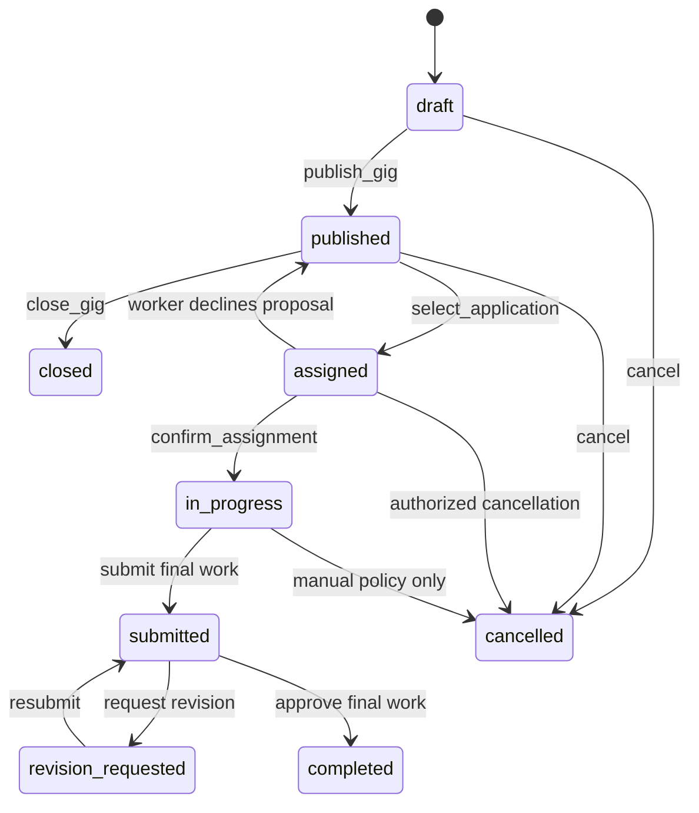
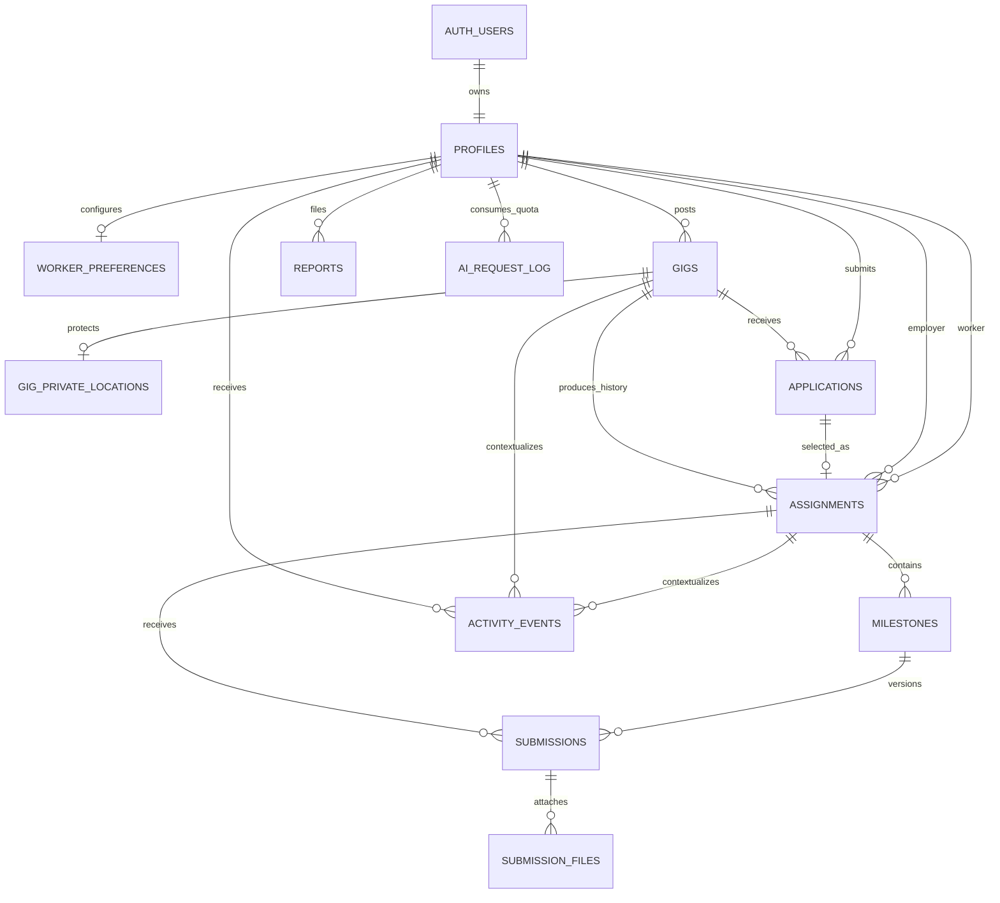

# Database Schema

## Status and invariants

M02 implemented this Phase 3 PostgreSQL contract as ordered local Supabase migrations and generated TypeScript types, merged in PR #19. It is not deployed or linked to a hosted project. The latest verified local evidence is a clean reset, 5 functional pgTAP files / 50 passing tests, a separate 5-assertion performance suite over 10,000 gigs and 50,000 applications, clean database lint, and current generated types.

The design preserves these invariants:

1. One `auth.users` identity owns one profile and can use both worker and employer modes. Mode is a UI preference, not an authorization role.
2. A published gig has exactly one employer and at most one live assignment.
3. A worker cannot apply to their own gig or hold two live applications for the same gig.
4. Hiring, agreement, submission review, and completion are transactional state transitions, not arbitrary client updates.
5. Precise worker and gig coordinates are private. Discovery exposes only a locality and coarse coordinates.
6. Retried mutations are deduplicated with a caller-generated UUID scoped to the authenticated user.
7. All timestamps are UTC `timestamptz`; display conversion happens in the client.

Use `gen_random_uuid()` for UUIDs. Prefer `text` plus named `CHECK` constraints over PostgreSQL enum types so adding a value is a backward-compatible migration. Every mutable table gets `created_at default now()`, `updated_at default now()`, and the shared `set_updated_at()` trigger. Clients may not write either timestamp.

## Tables

Lengths below are database constraints, not merely UI guidance. Boundary schemas must enforce the same or narrower limits.

### `profiles`

| Column                    | Type          | Null/default         | Rules                                           |
| ------------------------- | ------------- | -------------------- | ----------------------------------------------- |
| `id`                      | `uuid`        | PK                   | FK `auth.users(id) ON DELETE CASCADE`           |
| `display_name`            | `text`        | not null             | trimmed, 2-80 characters                        |
| `avatar_path`             | `text`        | null                 | relative path only, max 300; never a signed URL |
| `bio`                     | `text`        | null                 | max 500                                         |
| `preferred_mode`          | `text`        | not null, `'worker'` | `worker` or `employer`; affects navigation only |
| `home_area`               | `text`        | null                 | max 120; public label, not an address           |
| `onboarding_completed_at` | `timestamptz` | null                 | marketplace RPCs require non-null               |
| `created_at`              | `timestamptz` | not null, `now()`    |                                                 |
| `updated_at`              | `timestamptz` | not null, `now()`    | trigger-maintained                              |

Do not duplicate email or OAuth identity data here; `auth.users` remains authoritative. Index `(updated_at desc)` only if an admin operation later proves it useful.

### `worker_preferences`

One private preference record per user.

| Column                 | Type           | Null/default            | Rules                                                 |
| ---------------------- | -------------- | ----------------------- | ----------------------------------------------------- |
| `id`                   | `uuid`         | PK, `gen_random_uuid()` |                                                       |
| `profile_id`           | `uuid`         | not null, unique        | FK `profiles(id) ON DELETE CASCADE`                   |
| `accepts_onsite`       | `boolean`      | not null, `true`        |                                                       |
| `accepts_remote`       | `boolean`      | not null, `true`        | at least one acceptance flag must be true             |
| `preferred_categories` | `text[]`       | not null, `'{}'`        | at most 12 unique allowed slugs                       |
| `max_distance_km`      | `smallint`     | not null, `10`          | 1-100                                                 |
| `location_label`       | `text`         | null                    | max 120                                               |
| `latitude`             | `numeric(9,6)` | null                    | -90 through 90; both coordinates null or both present |
| `longitude`            | `numeric(9,6)` | null                    | -180 through 180                                      |
| `created_at`           | `timestamptz`  | not null, `now()`       |                                                       |
| `updated_at`           | `timestamptz`  | not null, `now()`       | trigger-maintained                                    |

The exact preference coordinates are readable only by their owner. P0 distance filtering can use a parameterized Haversine SQL function. PostGIS is an optional later optimization after query-plan evidence, not an M02 dependency.

### `gigs`

| Column                 | Type            | Null/default            | Rules                                                                                                                     |
| ---------------------- | --------------- | ----------------------- | ------------------------------------------------------------------------------------------------------------------------- |
| `id`                   | `uuid`          | PK, `gen_random_uuid()` |                                                                                                                           |
| `employer_id`          | `uuid`          | not null                | FK `profiles(id) ON DELETE RESTRICT`                                                                                      |
| `title`                | `text`          | not null                | trimmed, 5-100 characters                                                                                                 |
| `description`          | `text`          | not null                | trimmed, 20-4000 characters                                                                                               |
| `category`             | `text`          | not null                | approved slug; proposed P0 allowlist below                                                                                |
| `work_mode`            | `text`          | not null                | `onsite`, `remote`, or `hybrid`                                                                                           |
| `public_area`          | `text`          | null                    | max 120; required unless remote                                                                                           |
| `public_latitude`      | `numeric(4,2)`  | null                    | coarse only, -90 through 90                                                                                               |
| `public_longitude`     | `numeric(5,2)`  | null                    | coarse only, -180 through 180                                                                                             |
| `budget_amount`        | `numeric(12,2)` | not null                | greater than 0 and at most 1,000,000                                                                                      |
| `currency`             | `char(3)`       | not null, `'PHP'`       | P0 requires `PHP`                                                                                                         |
| `status`               | `text`          | not null, `'draft'`     | `draft`, `published`, `assigned`, `in_progress`, `submitted`, `revision_requested`, `completed`, `closed`, or `cancelled` |
| `application_deadline` | `timestamptz`   | null                    | before `due_at` when both exist                                                                                           |
| `due_at`               | `timestamptz`   | null                    | must be future when publishing                                                                                            |
| `published_at`         | `timestamptz`   | null                    | set only by publish RPC                                                                                                   |
| `closed_at`            | `timestamptz`   | null                    | set on terminal/closed states                                                                                             |
| `created_at`           | `timestamptz`   | not null, `now()`       |                                                                                                                           |
| `updated_at`           | `timestamptz`   | not null, `now()`       | optimistic-concurrency token                                                                                              |

The current eight-category list is provisional pending product approval before M05: `errands`, `delivery`, `cleaning`, `events`, `admin`, `tutoring`, `digital`, `other`. M02 encodes it in a named check constraint; changing the allowlist later must use a backward-compatible migration. Onsite/hybrid rows require public area and coarse coordinates; remote rows require coordinates to be null.

Indexes:

- `(employer_id, created_at desc)` for employer management;
- partial `(status, published_at desc)` where `status = 'published'` for discovery;
- partial `(work_mode, category, published_at desc)` where `status = 'published'`;
- partial `(public_latitude, public_longitude)` where `status = 'published' and work_mode <> 'remote'`.

### `gig_private_locations`

Optional exact location separated from the discoverable gig row.

| Column         | Type           | Null/default            | Rules                           |
| -------------- | -------------- | ----------------------- | ------------------------------- |
| `id`           | `uuid`         | PK, `gen_random_uuid()` |                                 |
| `gig_id`       | `uuid`         | not null, unique        | FK `gigs(id) ON DELETE CASCADE` |
| `address_text` | `text`         | null                    | max 300                         |
| `instructions` | `text`         | null                    | max 500, no secrets             |
| `latitude`     | `numeric(9,6)` | not null                | -90 through 90                  |
| `longitude`    | `numeric(9,6)` | not null                | -180 through 180                |
| `created_at`   | `timestamptz`  | not null, `now()`       |                                 |
| `updated_at`   | `timestamptz`  | not null, `now()`       |                                 |

Only the employer and the worker on a confirmed, non-terminal assignment may read this row.

### `applications`

| Column              | Type          | Null/default            | Rules                                                      |
| ------------------- | ------------- | ----------------------- | ---------------------------------------------------------- |
| `id`                | `uuid`        | PK, `gen_random_uuid()` |                                                            |
| `gig_id`            | `uuid`        | not null                | FK `gigs(id) ON DELETE CASCADE`                            |
| `worker_id`         | `uuid`        | not null                | FK `profiles(id) ON DELETE RESTRICT`                       |
| `message`           | `text`        | null                    | max 1000                                                   |
| `status`            | `text`        | not null, `'pending'`   | `pending`, `withdrawn`, `accepted`, `rejected`, `declined` |
| `client_request_id` | `uuid`        | not null                | retry dedupe key                                           |
| `decided_at`        | `timestamptz` | null                    | server-maintained                                          |
| `created_at`        | `timestamptz` | not null, `now()`       |                                                            |
| `updated_at`        | `timestamptz` | not null, `now()`       |                                                            |

Constraints/indexes:

- unique `(worker_id, client_request_id)`;
- partial unique `(gig_id, worker_id)` where status in (`pending`, `accepted`);
- partial unique `(gig_id)` where status = `accepted`;
- `(gig_id, status, created_at desc)` for employer review;
- `(worker_id, created_at desc)` for worker history.

Self-application cannot be expressed as a row-only check; the application RPC locks and checks the gig owner.

### `assignments`

An immutable agreement snapshot plus its workflow state.

| Column                  | Type            | Null/default            | Rules                                                                                            |
| ----------------------- | --------------- | ----------------------- | ------------------------------------------------------------------------------------------------ |
| `id`                    | `uuid`          | PK, `gen_random_uuid()` |                                                                                                  |
| `gig_id`                | `uuid`          | not null                | FK `gigs(id) ON DELETE RESTRICT`                                                                 |
| `application_id`        | `uuid`          | not null, unique        | FK `applications(id) ON DELETE RESTRICT`                                                         |
| `employer_id`           | `uuid`          | not null                | FK `profiles(id) ON DELETE RESTRICT`                                                             |
| `worker_id`             | `uuid`          | not null                | FK `profiles(id) ON DELETE RESTRICT`; differs from employer                                      |
| `agreement_version`     | `integer`       | not null, `1`           | greater than 0                                                                                   |
| `agreed_title`          | `text`          | not null                | 5-100                                                                                            |
| `agreed_description`    | `text`          | not null                | 20-4000                                                                                          |
| `agreed_amount`         | `numeric(12,2)` | not null                | greater than 0                                                                                   |
| `currency`              | `char(3)`       | not null, `'PHP'`       | P0 requires `PHP`                                                                                |
| `due_at`                | `timestamptz`   | null                    | agreement snapshot                                                                               |
| `status`                | `text`          | not null, `'proposed'`  | `proposed`, `active`, `submitted`, `revision_requested`, `completed`, `declined`, or `cancelled` |
| `employer_confirmed_at` | `timestamptz`   | not null                | selection time                                                                                   |
| `worker_confirmed_at`   | `timestamptz`   | null                    | required before active work                                                                      |
| `started_at`            | `timestamptz`   | null                    |                                                                                                  |
| `completed_at`          | `timestamptz`   | null                    |                                                                                                  |
| `cancelled_at`          | `timestamptz`   | null                    |                                                                                                  |
| `client_request_id`     | `uuid`          | not null                | employer selection dedupe key                                                                    |
| `created_at`            | `timestamptz`   | not null, `now()`       |                                                                                                  |
| `updated_at`            | `timestamptz`   | not null, `now()`       |                                                                                                  |

Constraints/indexes:

- unique `(employer_id, client_request_id)`;
- partial unique `(gig_id)` where status not in (`declined`, `cancelled`), enforcing one live worker;
- `(worker_id, status, updated_at desc)` and `(employer_id, status, updated_at desc)`;
- RPC verifies the application, gig, employer, and worker columns agree. Clients never insert or alter identity/agreement fields directly.

### `milestones`

| Column          | Type          | Null/default            | Rules                                                                                |
| --------------- | ------------- | ----------------------- | ------------------------------------------------------------------------------------ |
| `id`            | `uuid`        | PK, `gen_random_uuid()` |                                                                                      |
| `assignment_id` | `uuid`        | not null                | FK `assignments(id) ON DELETE CASCADE`                                               |
| `position`      | `smallint`    | not null                | 1-20, unique within assignment                                                       |
| `title`         | `text`        | not null                | 2-100                                                                                |
| `description`   | `text`        | null                    | max 1000                                                                             |
| `due_at`        | `timestamptz` | null                    |                                                                                      |
| `status`        | `text`        | not null, `'pending'`   | `pending`, `in_progress`, `submitted`, `revision_requested`, `approved`, `cancelled` |
| `approved_at`   | `timestamptz` | null                    |                                                                                      |
| `created_at`    | `timestamptz` | not null, `now()`       |                                                                                      |
| `updated_at`    | `timestamptz` | not null, `now()`       |                                                                                      |

Unique `(assignment_id, position)` and index `(assignment_id, status, position)`.

### `submissions`

Each row is a reviewable version; revisions create a new row instead of overwriting evidence.

| Column              | Type          | Null/default                 | Rules                                                                        |
| ------------------- | ------------- | ---------------------------- | ---------------------------------------------------------------------------- |
| `id`                | `uuid`        | PK, `gen_random_uuid()`      |                                                                              |
| `assignment_id`     | `uuid`        | not null                     | FK `assignments(id) ON DELETE RESTRICT`                                      |
| `milestone_id`      | `uuid`        | null                         | FK `milestones(id) ON DELETE RESTRICT`; must belong to assignment            |
| `submitted_by`      | `uuid`        | not null                     | FK `profiles(id) ON DELETE RESTRICT`; must be assignment worker              |
| `version`           | `smallint`    | not null                     | greater than 0                                                               |
| `note`              | `text`        | null                         | max 2000                                                                     |
| `status`            | `text`        | not null, `'pending_upload'` | `pending_upload`, `submitted`, `revision_requested`, `approved`, `abandoned` |
| `review_note`       | `text`        | null                         | max 2000; required for revision                                              |
| `submitted_at`      | `timestamptz` | null                         | set only by successful finalization                                          |
| `reviewed_at`       | `timestamptz` | null                         |                                                                              |
| `client_request_id` | `uuid`        | not null                     | worker retry dedupe key                                                      |
| `created_at`        | `timestamptz` | not null, `now()`            |                                                                              |
| `updated_at`        | `timestamptz` | not null, `now()`            |                                                                              |

Unique `(submitted_by, client_request_id)`. Add a unique expression index on `(assignment_id, coalesce(milestone_id, '00000000-0000-0000-0000-000000000000'::uuid), version)` and an index `(assignment_id, created_at desc)`.

### `submission_files`

Metadata for objects in the private `submission-evidence` Storage bucket.

| Column          | Type          | Null/default            | Rules                                         |
| --------------- | ------------- | ----------------------- | --------------------------------------------- |
| `id`            | `uuid`        | PK, `gen_random_uuid()` |                                               |
| `submission_id` | `uuid`        | not null                | FK `submissions(id) ON DELETE CASCADE`        |
| `uploader_id`   | `uuid`        | not null                | FK `profiles(id) ON DELETE RESTRICT`          |
| `object_path`   | `text`        | not null, unique        | canonical relative object path, max 500       |
| `media_type`    | `text`        | not null                | allowlisted JPEG/PNG/WebP MIME type           |
| `size_bytes`    | `integer`     | not null                | 1 through configured maximum (proposed 5 MiB) |
| `created_at`    | `timestamptz` | not null, `now()`       |                                               |
| `updated_at`    | `timestamptz` | not null, `now()`       | normally unchanged                            |

Index `(submission_id, created_at)`. Object creation and metadata finalization use one authoritative three-step protocol: reserve the submission, upload only to its authorized path, then atomically finalize metadata/state. A reviewed maintenance procedure marks stale reservations abandoned and removes their unattached objects after the approved retention window.

### `activity_events`

One inbox row per recipient. Payloads are presentation hints, not an authorization source.

| Column          | Type          | Null/default            | Rules                                                                                                         |
| --------------- | ------------- | ----------------------- | ------------------------------------------------------------------------------------------------------------- |
| `id`            | `uuid`        | PK, `gen_random_uuid()` |                                                                                                               |
| `recipient_id`  | `uuid`        | not null                | FK `profiles(id) ON DELETE CASCADE`                                                                           |
| `actor_id`      | `uuid`        | null                    | FK `profiles(id) ON DELETE SET NULL`                                                                          |
| `gig_id`        | `uuid`        | null                    | FK `gigs(id) ON DELETE CASCADE`                                                                               |
| `assignment_id` | `uuid`        | null                    | FK `assignments(id) ON DELETE CASCADE`                                                                        |
| `event_type`    | `text`        | not null                | conservative lowercase snake-case syntax; semantic allowlist is added with the workflow that emits each event |
| `payload`       | `jsonb`       | not null, `'{}'`        | object, max serialized size 4 KiB; no secrets, email, address, or model prompt                                |
| `dedupe_key`    | `text`        | not null                | deterministic event key, max 160                                                                              |
| `read_at`       | `timestamptz` | null                    | recipient-controlled only                                                                                     |
| `created_at`    | `timestamptz` | not null, `now()`       |                                                                                                               |
| `updated_at`    | `timestamptz` | not null, `now()`       |                                                                                                               |

Unique `(recipient_id, dedupe_key)` and index `(recipient_id, read_at, created_at desc)`. M02 validates only a conservative lowercase snake-case event syntax because the emitting workflows are deferred. Events remain non-client-writable and will be written only by transactional RPCs or trusted server code.

### `reports`

| Column               | Type          | Null/default            | Rules                                                           |
| -------------------- | ------------- | ----------------------- | --------------------------------------------------------------- |
| `id`                 | `uuid`        | PK, `gen_random_uuid()` |                                                                 |
| `reporter_id`        | `uuid`        | not null                | FK `profiles(id) ON DELETE RESTRICT`                            |
| `subject_profile_id` | `uuid`        | null                    | FK `profiles(id) ON DELETE RESTRICT`                            |
| `gig_id`             | `uuid`        | null                    | FK `gigs(id) ON DELETE SET NULL`                                |
| `assignment_id`      | `uuid`        | null                    | FK `assignments(id) ON DELETE SET NULL`                         |
| `category`           | `text`        | not null                | approved allowlist: scam, unsafe, harassment, prohibited, other |
| `details`            | `text`        | not null                | trimmed, 20-2000                                                |
| `status`             | `text`        | not null, `'open'`      | `open`, `reviewing`, `resolved`, `dismissed`                    |
| `resolution_note`    | `text`        | null                    | server/admin only, max 2000                                     |
| `client_request_id`  | `uuid`        | not null                | reporter retry dedupe key                                       |
| `created_at`         | `timestamptz` | not null, `now()`       |                                                                 |
| `updated_at`         | `timestamptz` | not null, `now()`       |                                                                 |

At least one subject column must be non-null; a reporter cannot report themselves. Unique `(reporter_id, client_request_id)` and indexes `(reporter_id, created_at desc)` and `(status, created_at)` for trusted moderation. P0 has no mobile admin policy.

### `ai_request_log`

Minimal operational metadata for rate limits and idempotency; never store prompt or generated content.

| Column         | Type          | Null/default            | Rules                                                            |
| -------------- | ------------- | ----------------------- | ---------------------------------------------------------------- |
| `id`           | `uuid`        | PK, `gen_random_uuid()` |                                                                  |
| `user_id`      | `uuid`        | not null                | FK `profiles(id) ON DELETE CASCADE`                              |
| `request_id`   | `uuid`        | not null                | client idempotency key                                           |
| `provider`     | `text`        | not null                | configured provider identifier, max 40                           |
| `status`       | `text`        | not null                | `reserved`, `succeeded`, `failed`, `timed_out`, `invalid_output` |
| `input_chars`  | `integer`     | not null                | 0-8000                                                           |
| `output_chars` | `integer`     | null                    | 0-12000                                                          |
| `duration_ms`  | `integer`     | null                    | nonnegative                                                      |
| `error_code`   | `text`        | null                    | stable non-sensitive code, max 60                                |
| `created_at`   | `timestamptz` | not null, `now()`       | quota window                                                     |
| `updated_at`   | `timestamptz` | not null, `now()`       |                                                                  |

Unique `(user_id, request_id)` and indexes `(user_id, created_at desc)` plus a partial `(status, created_at)` for stale reservations. No direct client CRUD; authenticated RPCs reserve/finalize requests.

## Profile creation from `auth.users`

An `AFTER INSERT` trigger creates the minimal profile in the same transaction as the Auth user. It must be `SECURITY DEFINER`, set an empty search path, schema-qualify every object, and copy only a safe display-name candidate from metadata. It must never copy provider tokens.

```sql
create function public.handle_new_auth_user()
returns trigger
language plpgsql
security definer set search_path = ''
as $$
declare
  candidate text;
begin
  candidate := nullif(btrim(coalesce(new.raw_user_meta_data ->> 'full_name', '')), '');
  if candidate is null or char_length(candidate) < 2 then
    candidate := 'New user';
  end if;
  insert into public.profiles (id, display_name)
  values (new.id, left(coalesce(candidate, 'New user'), 80))
  on conflict (id) do nothing;
  return new;
end;
$$;
```

The migration must revoke function execution from `public`, install the trigger on `auth.users`, and include an integration test for Google-like metadata, email/password metadata, missing metadata, retry, and Auth-user deletion. A failed trigger can block signup, so keep it minimal; onboarding is a separate authenticated update.

## State machines

The intended transitions use named RPCs with row locks and compare the current state. M02 does not add no-op workflow RPCs: real transactional implementations are deferred to the milestones that deliver each workflow, and direct client updates to workflow tables/state columns remain fail-closed meanwhile.

### Gig



Post-assignment cancellation/dispute rules are still a product blocker; until approved, P0 must reject that transition rather than invent policy.

### Application and assignment

- Application: `pending -> withdrawn`; `pending -> accepted|rejected`; `accepted -> declined` only when the selected worker rejects the proposal.
- Assignment: `proposed -> active|declined`; `active -> submitted`; `submitted -> revision_requested|completed`; `revision_requested -> submitted`; pre-work `proposed -> cancelled` where allowed.
- Employer selection locks the gig and all pending applications, accepts one, rejects the rest, creates the assignment snapshot and activity rows, and changes the gig to `assigned` in one transaction.
- Worker confirmation locks the assignment and matching gig. Decline releases the gig to `published` only if its deadline has not passed; otherwise it closes it.

### Milestone and submission

- Milestone: `pending -> in_progress -> submitted -> approved`; `submitted -> revision_requested -> submitted`; cancellation follows the assignment only.
- `begin_submission` allocates or returns the same `pending_upload` submission/version under the worker's idempotency key while holding the milestone/assignment lock; it does not advance aggregate work state.
- `finalize_submission` verifies the reserved object paths and metadata, changes the submission to `submitted`, and advances milestone/assignment/gig state atomically. A submission is never considered submitted merely because an upload succeeded.
- `review_submission` can review only the newest submitted version. Approval marks the milestone approved; the final milestone completes the assignment/gig only when every milestone is approved. Revision updates aggregate states atomically.

## Transactional RPC boundary

The public data API may handle safe CRUD for profile/preferences and employer-owned drafts. The following actions must be PostgreSQL functions, not multi-call client workflows:

| RPC                                                                      | Lock/check/write                                                                                                                                                                                    |
| ------------------------------------------------------------------------ | --------------------------------------------------------------------------------------------------------------------------------------------------------------------------------------------------- |
| `publish_gig(gig_id, expected_updated_at)`                               | owner + onboarding; validates complete brief/deadline/location; `FOR UPDATE`; sets publish fields                                                                                                   |
| `apply_to_gig(gig_id, message, client_request_id)`                       | authenticated worker; locks published gig; checks deadline/not owner; dedupes; inserts application/event                                                                                            |
| `withdraw_application(application_id)`                                   | pending application owner; locks row; changes status                                                                                                                                                |
| `select_application(application_id, client_request_id)`                  | gig employer; locks gig/applications; prevents live assignment; snapshots terms; rejects competitors; emits events                                                                                  |
| `confirm_assignment(assignment_id, accept)`                              | selected worker; locks assignment/gig; confirms or releases proposal                                                                                                                                |
| `begin_submission(assignment_id, milestone_id, note, client_request_id)` | assigned worker; validates state, locks aggregates, allocates/returns one `pending_upload` version and authorized object-path prefix without advancing work state                                   |
| `finalize_submission(submission_id, files, client_request_id)`           | same worker/key; verifies every private object and limits, inserts immutable file metadata, changes submission/aggregates to `submitted`, emits events; identical retry returns the original result |
| `review_submission(submission_id, decision, review_note)`                | gig employer; checks newest version; advances milestone/assignment/gig/events                                                                                                                       |
| `mark_activity_read(event_ids uuid[])`                                   | recipient only; bounded array (max 100)                                                                                                                                                             |
| `create_report(...)`                                                     | authenticated and context participant/public-gig viewer; validates subject and dedupes                                                                                                              |
| `reserve_ai_request(request_id, provider)`                               | onboarding + quota; returns existing reservation/result state on retry                                                                                                                              |

These are planned contracts, not M02 implementations. When each function is added, it must use `auth.uid()` rather than a caller-supplied identity, `SECURITY DEFINER` only when required, `set search_path = ''`, schema-qualified names, explicit grants, and typed error codes. See `SECURITY_AND_RLS.md`.

## Deletion and retention

- Auth-user deletion cascades profile/preferences/activity inbox/AI metadata, but `RESTRICT` on marketplace history intentionally prevents accidental account deletion after participation. A future account-deletion service must anonymize retained marketplace records in a controlled transaction before deleting Auth data.
- Draft gigs may be hard-deleted by their employer when they have no applications; published or participated gigs are closed/cancelled, not deleted.
- Assignments, submissions, and reports are not client-deletable.
- Evidence retention duration is unresolved. Before M09, choose a period and implement a scheduled/manual cleanup that deletes Storage objects and metadata consistently.

The cancellation rules for each active state and the final agreement-confirmation sequence are also unresolved. Do not broaden transitions or add destructive cleanup until those product decisions are approved.

## Entity relationship diagram



## Migration and performance proof

M02 should split this into additive migrations: extensions/helpers and profiles; marketplace tables; workflow functions; RLS; Storage policies; seed/test fixtures. Run migrations from empty and against the previous migration, generate types, and test rollback by resetting the disposable local database (production migrations remain forward-only).

Required `EXPLAIN (ANALYZE, BUFFERS)` fixtures must cover at least 10,000 gigs and 50,000 applications:

- published discovery by mode/category and recency;
- employer application list;
- worker active assignments;
- unread activity feed;
- AI quota count for the current user/window.

No query plan is claimed yet. Acceptance requires indexed plans without sequential scans on growing user tables unless measurements justify them.
