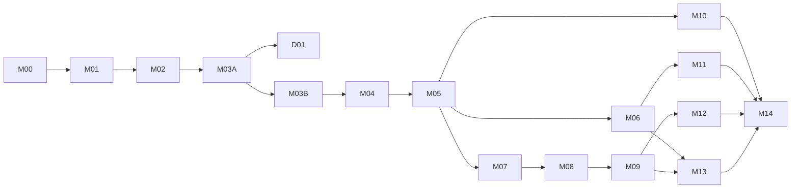

# Do Well Implementation Plan and Roadmap

> **For Claude:** Use the `executing-plans` skill to execute one approved milestone at a time. Apply `test-driven-development` during implementation and `verification-before-completion` before changing a milestone status.

**Goal:** deliver a secure, zero-external-cost Android MVP through small, independently reviewable milestones that survive session handoffs.

**Architecture:** one Expo/TypeScript mobile application backed by Supabase Auth, PostgreSQL/RLS, private Storage, and narrowly scoped Edge Functions. Optional AI, map, and remote-push integrations remain behind safe feature flags until their feasibility and cost are proven.

**Tech stack:** React Native, Expo development builds, Expo Router, TypeScript strict mode, Supabase, PostgreSQL, Zod, TanStack Query, Android device APIs, and project-local pinned tooling.

---

## How to use this roadmap

- Status values are `NOT STARTED`, `IN PROGRESS`, `BLOCKED`, or `COMPLETED`. Only verification evidence in the linked issue/PR permits `COMPLETED`.
- Start from current `main`, create the listed short-lived branch, and keep one GitHub Issue and one cohesive PR per milestone unless the issue is explicitly split before work.
- Every PR uses `.github/pull_request_template.md`, links the issue, records commands/results, screenshots where relevant, security/cost review, known limitations, and the next milestone.
- Do not merge without user approval. After merge, update `docs/SESSION_HANDOFF.md`, this roadmap, and the issue.
- No implementation task may expose credentials, enable billing, add a payment method, or depend on automatic overage.

## Test-first and commit expectations

For every behavior-bearing task:

1. Write a focused failing unit/component/SQL/contract test.
2. Run the narrow test and record the expected failure.
3. Implement the smallest passing behavior.
4. Run the narrow test, then the milestone suite.
5. Refactor only while green and commit one logical unit using Conventional Commits.

Pure configuration/docs tasks use a failing validation or reproducible check instead of a contrived unit test. Schema work follows **expand → migrate/backfill → contract**, with RLS negative tests before client use. Generated database types are refreshed after migrations and never hand-edited.

## Milestone dependency map

This retains the requested M00–M14 ordering. M10–M13 may be developed in parallel after their dependencies, but each remains independently reviewable.

## Status summary

| Milestone | Deliverable                                                               | Status          | Issue                                                  |
| --------- | ------------------------------------------------------------------------- | --------------- | ------------------------------------------------------ |
| M00       | Repository security, architecture documentation, private GitHub setup     | **COMPLETED**   | [#1](https://github.com/DanielHC16/do-well/issues/1)   |
| M01       | Expo initialization, pinned tooling, CI, Android development build        | **COMPLETED**   | [#2](https://github.com/DanielHC16/do-well/issues/2)   |
| M02       | Supabase local config, schema foundations, migrations and generated types | **COMPLETED**   | [#3](https://github.com/DanielHC16/do-well/issues/3)   |
| M03A      | Authentication and profile foundation                                     | **COMPLETED**   | [#4](https://github.com/DanielHC16/do-well/issues/4)   |
| M03B      | Hosted auth and physical-device acceptance                                | **DEFERRED**    | [#4](https://github.com/DanielHC16/do-well/issues/4)   |
| D01       | Offline Demo Preview: complete local gig lifecycle                        | **COMPLETED**   | [#23](https://github.com/DanielHC16/do-well/issues/23)  |
| M04       | Shared shell and worker/employer navigation                               | **COMPLETED**   | [#5](https://github.com/DanielHC16/do-well/issues/5)   |
| M05       | Gig creation and employer management                                      | **COMPLETED**   | [#6](https://github.com/DanielHC16/do-well/issues/6)   |
| M06       | Nearby/remote discovery and explainable filtering                         | **COMPLETED**   | [#7](https://github.com/DanielHC16/do-well/issues/7)   |
| M07       | Worker applications and employer selection                                | **COMPLETED**   | [#8](https://github.com/DanielHC16/do-well/issues/8)   |
| M08       | Agreements, milestones, activity, state transitions                       | **COMPLETED**   | [#9](https://github.com/DanielHC16/do-well/issues/9)   |
| M09       | Submission, evidence metadata, revision and approval                      | **COMPLETED**   | [#10](https://github.com/DanielHC16/do-well/issues/10) |
| M10       | Zero-cost AI Job Brief Builder feasibility and implementation             | **COMPLETED**   | [#11](https://github.com/DanielHC16/do-well/issues/11) |
| M11       | Android foreground location and optional map feasibility                  | **COMPLETED**   | [#12](https://github.com/DanielHC16/do-well/issues/12) |
| M12       | Local notifications and image evidence integration                        | **COMPLETED**   | [#13](https://github.com/DanielHC16/do-well/issues/13) |
| M13       | Connectivity resilience, cached reads and offline drafts                  | **COMPLETED**   | [#14](https://github.com/DanielHC16/do-well/issues/14) |
| M14       | Security verification, end-to-end tests and competition build             | **COMPLETED**   | [#15](https://github.com/DanielHC16/do-well/issues/15) |
| M15       | Repository truth, zero-secret CI workflow, and productization reset       | **COMPLETED**   | [#40](https://github.com/DanielHC16/do-well/issues/40) |
| M16       | Hosted backend parity and Google authentication acceptance                | **IN PROGRESS** | [#41](https://github.com/DanielHC16/do-well/issues/41) |
| M17       | Settings, workspace preference persistence, and admin capability foundation| **COMPLETED**   | [#42](https://github.com/DanielHC16/do-well/issues/42) |
| M18       | Functional reporting and moderation console                               | **COMPLETED**   | [#43](https://github.com/DanielHC16/do-well/issues/43) |
| M19       | Presentation refinement and honest production copy                        | **IN PROGRESS** | [#44](https://github.com/DanielHC16/do-well/issues/44) |
| M20       | Live demo environment, dual-identity scenario, and release proof           | **IN PROGRESS** | [#45](https://github.com/DanielHC16/do-well/issues/45) |

## M00 — Secure repository and approve architecture

**Status:** `COMPLETED` after private-repository verification and merge of PR #16 on 2026-10-22.

- **Goal:** establish a safe private repository and durable source of truth before application code.
- **Dependencies:** verified GitHub owner/account; repository-local name/email; access to requirements.
- **Scope/tasks:** validate ignore rules without reading secret contents; preserve local credential files; sanitize `.env.example`; establish `main`; create private `DanielHC16/do-well`; add labels and M00–M14 tracking issues; author docs/ADRs/handoff; open the Phase 3 documentation PR; record unresolved competition rules.
- **Likely files:** `.gitignore`, `.env.example`, `.gitattributes`, `README.md`, `AGENTS.md`, `.github/**`, `docs/**`.
- **Credentials/config:** GitHub CLI must be authenticated as the intended owner and repository-local Git identity must be verified. No application/service credential is needed or read.
- **Verification:** `git status --short --branch`; `git check-ignore -v .env.local client_secret_*.json`; `git diff --check`; `git ls-files`; `gh repo view DanielHC16/do-well --json nameWithOwner,visibility,defaultBranchRef`; `gh pr view --json url,state,headRefName,baseRefName`; inspect `gh issue list` and label list. Expected: secrets ignored/untracked, private repo, `main` default, docs PR open from `docs/phase3-architecture`.
- **Acceptance / DoD:** safe bootstrap is on `main`; all required docs contain substantive content; no secret file/value is tracked or printed; private remote and repository visibility are verified; milestone issues/labels and docs PR exist; reviewer findings are resolved or documented; handoff names the next task.
- **Branch / commits:** bootstrap exception directly on `main`: `chore(setup): secure repository bootstrap`; documentation on `docs/phase3-architecture`: `docs(architecture): define phase 3 system design` and `docs(roadmap): define milestone delivery plan` (combine only if the diff is one cohesive review unit).
- **Issue / PR:** M00 issue links requirement source and checklist. Documentation PR targets `main`, links M00, includes cost/security review, and must not merge before plan approval.
- **Risks / rollback:** accidental credential staging (remove from index before any push and rotate if exposure is possible); wrong Git identity/owner; inaccessible requirements; unverified competition rules. Documentation is reversible by PR; do not rewrite history or delete credential files.

## M01 — Initialize Expo and prove Android development

**Status:** `COMPLETED` — scaffold, checks, smoke screen, development-build configuration, local APK compilation, emulator launch, and physical-device installation/launch evidence are verified; [PR #17](https://github.com/DanielHC16/do-well/pull/17) was approved and merged.

- **Goal:** create the smallest strict TypeScript Expo Router app and run a development build on the target physical Android device.
- **Dependencies:** M00 approved/merged; competition permits Expo/React Native; target phone model/Android version known; supported Node/JDK/Android SDK matrix verified from official docs.
- **Scope/tasks:** pin Node and package manager; scaffold in the existing repo without overwriting docs; configure strict TypeScript, lint, formatting, Jest 30 with `jest-expo` and React Native Testing Library 14+, package scripts, Expo Router, stable application IDs after approval, environment validation, placeholder accessible screen, local verification, conditional CI, and development-build instructions. Correct Java/Android environment selection without installing mutable global CLIs.
- **Likely files:** `package.json`, lockfile, `.nvmrc`, `app.json` or `app.config.ts`, `eas.json` if EAS is approved, `tsconfig.json`, `eslint.config.*`, test config/setup, `app/_layout.tsx`, `app/index.tsx`, `src/shared/config/**`, `.github/workflows/ci.yml`, `docs/SETUP_GUIDE.md`.
- **Credentials/config:** safe Supabase placeholders only; optional Expo account for EAS ownership. No signing key or cloud credential committed.
- **Verification:** `node --version`; package-manager version; `java -version`; `adb devices`; `npm run format:check`; `npm run lint`; `npm run typecheck`; `npm run test:run`; `npx expo-doctor`; `npx expo config --type public`; run the documented Android development-build command and record device evidence.
- **Acceptance / DoD:** clean clone setup is reproducible in at most five primary commands after prerequisites; strict typecheck and starter tests pass locally; no secret appears in public Expo config; app opens on the named physical device; versions are pinned and documented. Hosted CI is enabled and green only after the owner verifies no valid payment method or an enforced zero-dollar stop-usage budget; until then, the issue records CI as cost-blocked and local checks are authoritative.
- **Branch / commits:** `chore/expo-initialization`; `chore(setup): initialize Expo TypeScript project`, `test(setup): add baseline application checks`, `ci: verify mobile project on pull requests`.
- **Issue / PR:** M01 issue records compatibility sources and device matrix. PR includes public Expo config excerpt with sensitive values redacted, CI link, and physical-device screenshot/log.
- **Risks / rollback:** newest Expo may exceed installed Node/API support; package ID/scheme is costly to change after integrations; scaffold may overwrite bootstrap. Pin the verified compatible release, keep generated native directories uncommitted, and revert the feature branch if the scaffold is unsuitable.

## M02 — Establish Supabase schema and authorization foundation

**Status:** `COMPLETED` after review and merge of [PR #19](https://github.com/DanielHC16/do-well/pull/19) on 2026-10-23. The pinned local CLI, isolated stack, ordered schema/RLS/Storage migrations, seed data, pgTAP tests, performance-plan suite, and generated-type workflow are on `main`. The verified evidence is a clean reset, 5 functional pgTAP files / 50 passing tests, a separate 5-assertion performance suite, clean database lint, and current generated types.

- **Goal:** represent the approved domain in repeatable migrations with deny-by-default RLS and local integration tests.
- **Dependencies:** M01 is complete. Cancellation semantics, agreement confirmation, and evidence-retention duration remain unresolved. The eight-category list is provisional and encoded with a named `CHECK` constraint so a later allowlist change is a backward-compatible migration.
- **Scope/tasks:** initialize local Supabase config; write check-constrained tables for profiles, preferences, gigs, applications, assignments, milestones, submissions, activity events, and reports; add constraints/indexes/timestamps; profile provisioning; RLS policies; private evidence bucket policy; representative seed fixtures; generate TypeScript types. Actual transactional/idempotent workflow RPCs are deferred to the milestones that implement those workflows; until then, direct workflow mutations remain fail-closed rather than being represented by no-op functions. Follow expand/migrate/contract for revisions.
- **Likely files:** `supabase/config.toml`, `supabase/migrations/*.sql`, `supabase/seed.sql`, `supabase/tests/**/*.sql`, `src/types/database.generated.ts`, `docs/DATABASE_SCHEMA.md`, `docs/SECURITY_AND_RLS.md`, relevant ADRs.
- **Credentials/config:** Supabase CLI `2.121.0` runs locally through Docker on isolated ports `55320`-`55329` plus inspector `5583`. `.env.local` must remain ignored and valid dotenv. Hosted linking/apply, billing, and payment methods are outside M02.
- **Verification:** project scripts are `db:start`, `db:stop`, `db:reset`, `db:lint`, `db:test`, `db:test:performance`, `db:types`, and `db:types:check`. The verified baseline is a clean reset, 5 files / 50 functional pgTAP tests, 5 performance assertions over 10,000 gigs and 50,000 applications, clean lint, and current generated types. Real JWT HTTP-path integration is deferred to M03.
- **Acceptance / DoD:** fresh local stack reaches current schema solely through migrations; constraints encode one worker/assignment and legal relationships; every exposed table has enabled/tested RLS; private bucket policy is tested; docs/diagram match migrations; no destructive hosted migration is applied in this milestone without separate approval.
- **Branch / commits:** `feat/database-schema`; `feat(db): add marketplace schema migrations`, `feat(security): enforce row level policies`, `test(db): verify tenant and role isolation`.
- **Issue / PR:** M02 issue links schema/RLS matrix and open product decisions. PR includes migration plan, test principals/results, data-loss/security review, and hosted-apply status.
- **Risks / rollback:** over-permissive RLS, irreversible status assumptions, free-project mismatch. Keep hosted application out of scope until review; correct schema with forward migrations; retain local seed/export recovery.

## M03 — Implement authentication and profile onboarding

**Status:** M03A `COMPLETED` on `feat/supabase-auth`; M03B `DEFERRED` by the owner's 2026-10-25 demo-first reprioritization. M03A delivers the tested client/session/onboarding foundation and local Auth/PostgREST JWT proof. M03B retains hosted OAuth, the deferred email/password acceptance decision, emulator connectivity diagnosis, and the physical-device matrix; those production gates are not represented as complete.

- **Goal:** safely authenticate, restore sessions, and ensure every user has one usable profile.
- **Dependencies:** M02; approved Android scheme/package; Google OAuth audience/test users and Supabase redirect allowlist configured by an authorized operator.
- **Scope/tasks:** test session state machine first; configure one Supabase client with the verified SDK-supported React Native storage adapter (documented AsyncStorage baseline; evaluate SecureStore only after token-size/platform tests); implement email/password; Google browser OAuth/deep-link validation; restore/refresh/logout; idempotent profile repair/provisioning; onboarding schemas/screens; auth error/retry/cancel states; clear user-scoped cache on logout.
- **Likely files:** `app/(public)/auth/callback.tsx`, `app/(public)/auth/reset-password.tsx`, `app/(public)/**`, `app/(onboarding)/**`, `app/_layout.tsx`, `src/features/auth/**`, `src/features/profile/**`, `src/shared/api/supabase.ts`, `src/shared/persistence/session-storage.ts`, auth tests, `docs/AUTHENTICATION.md`.
- **Credentials/config:** client-safe Supabase URL/publishable key; Google Web client configured in provider/dashboard, never its secret in the app. No privileged Supabase key.
- **Verification:** targeted auth unit/component tests; `npm run lint`; `npm run typecheck`; `npm run test:run`; deep-link command documented for Android; physical-device tests for Google success/cancel, email sign-in, restart restoration, token refresh simulation, and logout.
- **Acceptance / DoD:** both auth methods work on device; invalid/malicious callback is rejected; profile is created/repaired once; incomplete users cannot bypass onboarding; expiration and offline restoration have explicit UX; logout removes session/user cache; negative RLS tests still pass.
- **Branch / commits:** `feat/supabase-auth`; `test(auth): define session lifecycle behavior`, `feat(auth): add persistent Supabase sessions`, `feat(auth): implement onboarding and OAuth callback`.
- **Issue / PR:** M03 issue owns provider setup checklist without secrets. PR includes callback test evidence and security review; screenshots omit personal data.
- **Risks / rollback:** redirect mismatch, OAuth review/testing limits, corrupt session, secret accidentally treated as public. Email/password remains fallback; Google flag can be disabled; clear only app-owned secure keys during recovery.

## D01 — Deliver the offline Demo Preview

**Status:** `COMPLETED` after review and merge of [PR #24](https://github.com/DanielHC16/do-well/pull/24) on 2026-10-25. The isolated runtime, validated local lifecycle, persistence/reset behavior, project-specific noticeboard UI, full automated journey, Android bundle, and emulator walkthrough are verified.

- **Goal:** demonstrate create/publish -> discover/apply -> select -> submit -> approve on an Android emulator in under five minutes without an account or network.
- **Dependencies:** M01/M02 and accepted ADR 0006. D01 does not depend on M03B and does not complete M04-M09 production acceptance.
- **Scope/tasks:** explicit `EXPO_PUBLIC_APP_RUNTIME=demo`; isolated local provider/routes; two fictional personas; validated/versioned AsyncStorage state; deterministic reset; persistent demo disclosure; accessible temporary UI; automated lifecycle test; emulator runbook.
- **Acceptance / DoD:** the full local lifecycle works after a clean install, persists after restart, resets deterministically, rejects duplicate/invalid transitions, and passes format/lint/typecheck/Jest/Android emulator checks. Production remains the default when the runtime variable is unset.
- **Limitations:** no real authentication, cloud sync, RLS proof, multi-device concurrency, uploads, GPS/maps, payments, identity verification, or AI inference. All data is synthetic and every route says `DEMO MODE - LOCAL DATA`.
- **Branch / commits:** `feat/demo-preview`; small Conventional Commits following `docs/plans/2026-10-25-demo-first-mvp.md`.
- **Issue / PR:** one dedicated D01 issue and cohesive PR with exact demo script, verification evidence, cost/security review, limitations, and rollback.

## M04 — Add authenticated shell and dual-mode navigation

**Status:** `IN PROGRESS` on `feat/app-shell`

- **Goal:** provide a stable, accessible shell that switches worker/employer presentation without changing identity or authorization.
- **Dependencies:** M03; preliminary Phase 2 navigation direction, or approval to use replaceable temporary UI.
- **Scope/tasks:** test guards and mode persistence; create explicit `(app)/worker` and `(app)/employer` route layouts (route groups alone cannot distinguish identical paths), shared activity/profile/settings routes, role-mode switcher, not-found/error/loading states, design tokens and accessible primitives. Keep routes thin.
- **Likely files:** `app/(app)/**`, `src/features/profile/**`, `src/shared/ui/**`, `src/shared/persistence/mode.ts`, navigation/component tests.
- **Credentials/config:** none.
- **Verification:** `npm run lint`; `npm run typecheck`; targeted navigation/component tests; full unit suite; Android walkthrough for deep link/Back behavior, screen-reader labels, font scaling, focus, and mode persistence across restart.
- **Acceptance / DoD:** anonymous/onboarding users cannot enter the shell; both modes expose only relevant entry points; switching persists and never grants data access; loading/empty/error states exist; temporary UI is clearly documented for Phase 2 replacement.
- **Branch / commits:** `feat/dual-mode-navigation`; `test(navigation): define authenticated route guards`, `feat(navigation): add worker and employer shells`, `feat(ui): add accessible shared primitives`.
- **Issue / PR:** M04 issue includes route inventory and Phase 2 dependency. PR includes screenshots for both modes and accessibility checks.
- **Risks / rollback:** route loops, UI-mode mistaken for role authorization, rework from pending wireframes. Server policies remain authoritative; presentation components are isolated and reversible.

## M05 — Build gig creation and employer management

**Status:** `COMPLETED` after review and merge of [PR #27](https://github.com/DanielHC16/do-well/pull/27) (`464d06b`) on 2026-10-25.

- **Goal:** let employers draft, validate, publish, edit, close, and review one-worker gigs.
- **Dependencies:** M04; M02 gig schema/RLS; approved category and compensation rules.
- **Scope/tasks:** define form schema and failing transition/permission tests; employer gig list/detail/form; local draft; publish/edit/close services; server-enforced ownership/status rules; remote/onsite fields; precise-location privacy; invalidate query keys after mutations. AI entry point is disabled until M10.
- **Likely files:** `app/(app)/employer/gigs/**`, `src/features/gigs/**`, gig RPC/migration additions, RLS/integration/component tests.
- **Credentials/config:** client-safe Supabase configuration only.
- **Verification:** targeted schema/component tests; local RLS/RPC tests as employer/other user; `npm run lint`; `npm run typecheck`; full tests; Android walkthrough including validation, draft restore, publish retry, close.
- **Acceptance / DoD:** valid owned gig lifecycle works; invalid transitions/cross-user changes fail server-side; onsite/remote fields validate; public projection excludes private coordinates/address; duplicate publish does not duplicate records; all async states are visible.
- **Branch / commits:** `feat/gig-management`; `test(gigs): define creation and ownership rules`, `feat(gigs): add employer gig lifecycle`, `feat(gigs): preserve local creation drafts`.
- **Issue / PR:** M05 issue lists supported statuses/categories. PR links SQL and UI tests, screenshots, privacy review, and deferred cancellation rules.
- **Risks / rollback:** ambiguous scope/categories; coordinate leakage; draft schema drift. Feature can stay unpublished behind navigation flag; migrate drafts by version or discard with explicit warning.

## M06 — Deliver nearby/remote discovery and explainable ranking

**Status:** `COMPLETED` (merged via PR #28).

- **Goal:** help workers find published gigs with transparent list filtering that does not require a map.
- **Dependencies:** M05; worker preference foundation from M02; pilot radius decision before final acceptance. Location permission itself is implemented in M11, so M06 uses stored/manual locality/coordinates.
- **Scope/tasks:** test filters, distance calculation, privacy projection, pagination, and recommendation reason generation; implement discovery query/RPC, remote/local filters, paginated list/detail, manual location input, preferences, empty/error/offline-ready states, deterministic explanation chips.
- **Likely files:** `app/(app)/worker/index.tsx`, `app/(app)/worker/gigs/[gigId].tsx`, `src/features/discovery/**`, `src/features/profile/preferences/**`, SQL query/RPC/index migration and tests.
- **Credentials/config:** none beyond Supabase public config.
- **Verification:** unit tests for distance/boundaries/reasons; query/index/RLS tests with representative volume; component tests; lint/typecheck/full suite; Android test under throttled/failed network.
- **Acceptance / DoD:** only published eligible gigs appear; remote and nearby filters work; pagination is stable; reasons are deterministic and not falsely described as AI; no exact private address leaks; manual location makes nearby usable without permission/map.
- **Branch / commits:** `feat/gig-discovery`; `test(discovery): define filters and ranking reasons`, `feat(discovery): add paginated nearby and remote lists`, `feat(discovery): explain recommendation matches`.
- **Issue / PR:** M06 issue records radius and query plan. PR includes explain-plan/index evidence, UI states, privacy/security review.
- **Risks / rollback:** inaccurate coordinates, expensive distance query, ambiguous radius. Default to explicit locality and remote list; radius is configurable; disable distance sorting without breaking browsing.

## M07 — Add applications and atomic worker selection

**Status:** `COMPLETED` after review and merge of [PR #29](https://github.com/DanielHC16/do-well/pull/29) (`5d0dac5`) on 2026-10-25.

- **Goal:** allow workers to apply once and employers to privately review applicants and select exactly one.
- **Dependencies:** M05 and M06; M02 application/assignment constraints.
- **Scope/tasks:** test applicant privacy and duplicate races; application form/list/withdraw where allowed; employer applicants view; transactional selection RPC that locks the gig, accepts one application, rejects/closes competitors as approved, creates one assignment/activity event, and uses an idempotency key.
- **Likely files:** `app/(app)/worker/applications/**`, employer applicants route, `src/features/applications/**`, `src/features/assignments/**`, SQL RPC/policy/index migrations and tests.
- **Credentials/config:** none beyond Supabase public config.
- **Verification:** concurrent/duplicate selection SQL tests; RLS tests for worker A/B and unrelated employer; component tests; lint/typecheck/full suite; physical-device two-account walkthrough.
- **Acceptance / DoD:** one active application per worker/gig; only owner sees applicant private details; only owner can select; concurrent attempts yield one assignment; retries return the same result; users see stable conflict/error states.
- **Branch / commits:** `feat/applications`; `test(applications): define privacy and selection races`, `feat(applications): add worker application flow`, `feat(assignments): select one worker atomically`.
- **Issue / PR:** M07 issue documents concurrency semantics. PR includes negative authorization and repeated-request results.
- **Risks / rollback:** race condition hires two workers; rejected-applicant semantics unclear. Unique constraints plus transactional RPC are mandatory; keep selection disabled until tests pass.

## M08 — Implement agreements, milestones and activity

**Status:** `COMPLETED` after review and merge of [PR #30](https://github.com/DanielHC16/do-well/pull/30) (`9e177e1`) on 2026-10-25.

- **Goal:** give both participants a clear, auditable path from selection through in-progress milestones.
- **Dependencies:** M07; decision on two-party agreement confirmation and post-assignment cancellation/disputes.
- **Scope/tasks:** define/test state machine; immutable/versioned agreement snapshot; participant acceptance; ordered milestone creation/update rules; assignment detail; append-only activity events and basic task updates; transactional transition RPCs; authorization and idempotency tests.
- **Likely files:** worker/employer assignment routes, `src/features/assignments/**`, `src/features/activity/**`, migrations/RPCs/RLS/tests, state-machine docs.
- **Credentials/config:** none.
- **Verification:** state transition table tests including every forbidden edge; two-user RLS tests; component/activity ordering tests; lint/typecheck/full suite; Android end-to-end through in-progress.
- **Acceptance / DoD:** participants see the same agreement version and ordered milestones; only permitted actor triggers each transition; events are append-only and deduplicated; forbidden/out-of-order transitions fail; unresolved dispute behavior is not implied.
- **Branch / commits:** `feat/task-agreements`; `test(assignments): define agreement state machine`, `feat(assignments): add agreement and milestones`, `feat(activity): record idempotent task updates`.
- **Issue / PR:** M08 issue links approved transition matrix. PR includes diagram/table, authorization results, and product decisions.
- **Risks / rollback:** premature irreversible state model, mutable history, clock ordering. Use forward migration and feature flag; preserve event history; server timestamps are authoritative.

## M09 — Add work submission, revision and approval

**Status:** `COMPLETED` after review and merge of [PR #31](https://github.com/DanielHC16/do-well/pull/31) (`70c6032`) on 2026-10-25.

- **Goal:** complete the core workflow with secure submission records and employer review.
- **Dependencies:** M08; evidence metadata/storage design from M02; retention decision. Image-picker device integration is finalized in M12, so text/metadata submission lands first.
- **Scope/tasks:** test participant privacy and status transitions; worker submission form; revision request/response cycle; employer approval/completion; immutable submission versions; `begin_submission` reservation -> authorized private upload -> atomic `finalize_submission`; idempotent transactional RPCs and activity events; stale-reservation cleanup and reconciliation after timeout.
- **Likely files:** assignment routes, `src/features/submissions/**`, SQL migrations/RPCs/RLS/tests, component/integration tests.
- **Credentials/config:** Supabase public config; private Storage bucket configuration managed through migrations/policy, not public credentials.
- **Verification:** transition and RLS tests; repeated-submit/approve tests; component tests for pending/unknown/retry; lint/typecheck/full suite; two-account Android walkthrough.
- **Acceptance / DoD:** worker and owning employer only can access submission content; versions/history are preserved; no upload alone advances work state; retry cannot duplicate a reservation/version/event; stale reservations are recoverable/cleanable; revision and approval obey the state machine; completion is server-controlled.
- **Branch / commits:** `feat/work-submission`; `test(submissions): define review and privacy rules`, `feat(submissions): add versioned work review`, `feat(assignments): complete work atomically`.
- **Issue / PR:** M09 issue links state/evidence retention rules. PR includes negative access and timeout reconciliation evidence.
- **Risks / rollback:** premature completion, overwrite of evidence/history, orphan references. Keep completion RPC gated; retain append-only data; use forward corrective migration.

## M10 — Prove and implement the zero-cost AI Job Brief Builder

**Status:** `COMPLETED` on branch `feat/ai-job-builder`; ready for PR and merge.

- **Goal:** provide genuine, human-reviewed model inference at zero external spend—or explicitly block the AI claim with evidence.
- **Dependencies:** M05 manual gig flow; AI strategy/ADR; actual demo laptop and Android hardware/network available.
- **Scope/tasks:** first create a time-boxed benchmark comparing local LAN Ollama/open-weight model, realistic on-device option, and any verified no-billing tier; record model/license, RAM/storage, latency, reliability, privacy, and network requirements. Define versioned Zod request/response contract and eval set. If approved, implement provider adapter, authenticated Edge/local gateway, origin/device access controls, timeout/concurrency/input/output limits, structured safe errors, editable draft UI, explicit deterministic fallback label, and feature flag.
- **Likely files:** `src/features/ai-brief/**`, `app/modal/ai-brief.tsx`, `supabase/functions/ai-job-brief/**` or an approved local gateway directory, `tests/ai/**`, `docs/AI_STRATEGY.md`, AI ADR/eval results.
- **Credentials/config:** no paid API key. Any LAN gateway shared secret is generated per demo environment, stored outside Git/app public config, and rotated; Edge secrets set through operator tooling. Model files are not committed unless license/size policy explicitly permits.
- **Verification:** run fixed eval set for schema validity/content/latency; contract and hostile-input tests; authentication/rate-limit/timeout tests; lint/typecheck/full suite; physical Android test with provider available, provider slow, unavailable, malformed output, and no public internet.
- **Acceptance / DoD:** approved model performs actual inference within recorded device/demo thresholds; output always parses or fails safely; user edits/confirms before gig publish; endpoint is not publicly unsecured; manual form always works; UI never labels deterministic fallback as AI; zero billing and license are verified on the decision date. If no option passes, mark M10 `BLOCKED`, disable AI branding, and present evidence—do not fake capability.
- **Branch / commits:** `feat/ai-job-builder`; `test(ai): add job brief regression evals`, `feat(ai): add validated inference contract`, `feat(ai): add human-reviewed brief builder`.
- **Issue / PR:** M10 issue begins as feasibility gate with benchmark table and go/no-go checkbox. Implementation PR is opened only after decision; it includes model/license, threat/cost review, and eval artifacts.
- **Risks / rollback:** laptop cannot run model, unsafe LAN exposure, model/license change, latency, prompt injection. Feature defaults off; stop gateway and disable flag; manual builder remains complete.

## M11 — Add foreground location and decide map experience

**Status:** `COMPLETED` on branch `feat/android-location`; ready for PR and merge.

- **Goal:** improve nearby discovery with permission-aware foreground location while retaining a no-map/manual fallback.
- **Dependencies:** M06; physical Android devices; approved map/tile ADR if an interactive map is attempted.
- **Scope/tasks:** test permission state adapter; implement foreground one-shot/current location with accuracy/timeout bounds, disclosure, denial/permanent-denial handling, manual fallback, and freshness display. Benchmark MapLibre integration only if a tile source permits contest/demo use without billing/card/overage and attribution/offline terms are satisfied. Otherwise retain list-only UI.
- **Likely files:** `src/features/location/**`, discovery route/components, `app.config.ts` permission strings, optional `src/features/map/**`, Android tests, `docs/ANDROID_INTEGRATIONS.md`, map ADR.
- **Credentials/config:** ideally none. Any tile token must be demonstrably free, restricted, non-privileged, and approved; never use a billing-dependent Google Maps key.
- **Verification:** permission unit/component tests; lint/typecheck/full suite; physical-device cases for grant, denial, permanent denial, disabled services, stale fix, timeout, and manual location; if map included, verify attribution, offline/error fallback, API-key/public config, and provider policy date.
- **Acceptance / DoD:** nearby list works with granted location and manual input; precise location is not publicly exposed; denied/unavailable location never blocks remote/list browsing; no paid API/billing dependency; optional map failure degrades to the list.
- **Branch / commits:** `feat/android-location`; `test(location): define permission and fallback states`, `feat(location): add foreground nearby positioning`.
- **Issue / PR:** M11 issue owns provider feasibility and permission checklist. PR includes device matrix and map policy/attribution evidence if applicable.
- **Risks / rollback:** inaccurate position, permission distrust, native-build complexity, tile policy violation. Disable map/location flag and keep manual/list path; remove optional map dependency in a follow-up if rejected.

## M12 — Integrate local notifications and image evidence

**Status:** `COMPLETED` and merged via PR #34; corrective security and reliability hardening is tracked on `fix/m12-evidence-hardening`.

- **Goal:** provide reliable on-device reminders/activity cues and private image evidence without making remote push a P0 dependency.
- **Dependencies:** M09; M01 development build; private Storage policies from M02; retention/size/type rules approved.
- **Scope/tasks:** test notification scheduling/deduping and upload validation; request image access in context; select/compress/stage image; signed private upload with progress/cancel/retry; authorized signed viewing; cleanup orphan strategy; local notifications for relevant assignment deadlines/state changes already observed by the app. Treat remote push/FCM as a separately gated enhancement only if entirely free and justified.
- **Likely files:** `src/features/submissions/evidence/**`, `src/features/notifications/**`, evidence modal, `app.config.ts`, Storage/RLS migrations/tests, `docs/ANDROID_INTEGRATIONS.md`.
- **Credentials/config:** no credential for local notifications. Remote push would require separately approved Expo/Firebase configuration stored outside Git; absence cannot break P0.
- **Verification:** file type/size and Storage authorization tests; notification adapter tests; lint/typecheck/full suite; physical-device permission/select/upload/retry/view/delete/notification-tap cases; offline/large/invalid image tests.
- **Acceptance / DoD:** only authorized participants can upload/view evidence; public URLs are not stored; failed uploads preserve recoverable form state and do not create false completed submissions; local notifications are deduplicated and deep-link safely; remote push is clearly not claimed unless verified end to end.
- **Branch / commits:** `feat/android-evidence-notifications`; `test(evidence): define private upload rules`, `feat(evidence): add retryable private image upload`, `feat(notifications): add local assignment alerts`.
- **Issue / PR:** M12 issue separates local from remote notification scope. PR includes permission/device evidence, Storage negative tests, and retention/cost review.
- **Risks / rollback:** oversized files, orphan objects, leaked signed URLs, notification fatigue. Enforce caps/expiry, cleanup references, conservative channels, and flags to disable alerts/upload entry.

## M13 — Harden weak-connectivity behavior

**Status:** `NOT STARTED`

- **Goal:** make core P0 flows predictable under slow, intermittent, and lost connections without promising full offline synchronization.
- **Dependencies:** M06 and M09; mutation idempotency from M05–M09.
- **Scope/tasks:** create connectivity test matrix; test versioned draft repository, bounded user-scoped cache, pending/unknown mutation state, and reconciliation. Add stale timestamps/offline banner, persisted selected discovery/assignment snapshots, drafts for gig/application/submission, explicit retries, upload recovery, request timeouts, and user-switch purge. Evaluate background sync separately; keep disabled unless Android reliability is proven.
- **Likely files:** `src/shared/persistence/**`, `src/shared/api/**`, `src/features/*/drafts.ts`, connectivity provider/UI, tests, `docs/OFFLINE_STRATEGY.md`.
- **Credentials/config:** none.
- **Verification:** unit tests for draft version migration and user scoping; integration tests for duplicated/time-out mutations; lint/typecheck/full suite; device/proxy test matrix for offline launch, slow response, disconnect mid-submit/upload, restart, reconnect, token expiry, and account switch.
- **Acceptance / DoD:** previously selected data is visibly readable offline; forms survive restart; no duplicate server records after retries; uncertain results reconcile before resubmission; stale data is labelled; cache/session data does not leak across accounts; docs distinguish cache, drafts/pending actions, and background sync.
- **Branch / commits:** `feat/connectivity-resilience`; `test(offline): define cache and draft boundaries`, `feat(offline): persist user-scoped drafts and snapshots`, `feat(network): reconcile pending mutations`.
- **Issue / PR:** M13 issue owns the network-failure matrix. PR includes recorded results and storage/privacy bounds.
- **Risks / rollback:** stale/conflicting writes, unbounded storage, cross-account leakage. Use versioned bounded repositories, server versions/idempotency, purge on logout; disable persistence flag without affecting online flow.

## M14 — Verify security and produce competition build

**Status:** `COMPLETED`

- **Goal:** prove the approved MVP on target hardware and produce a reproducible competition artifact without billing or secret exposure.
- **Dependencies:** required M01–M13 paths complete; official competition rules, deadline, APK/AAB format, judging device/API, demo duration, and network conditions confirmed; plan approval for release/signing operations.
- **Scope/tasks:** freeze P0 scope; threat-model review; secret/dependency/license scans; full RLS/storage/Edge Function negative suite; end-to-end seeded scenario; AI/map/notifications truth-in-advertising review; accessibility/performance/weak-network/device matrix; recovery drill; backup/export rehearsal; build/sign approved artifact; checksum and release notes; demo script with offline/manual fallbacks.
- **Likely files:** `e2e/**`, security/integration tests, CI release workflow if approved, `eas.json`/app config, `docs/SETUP_GUIDE.md`, `docs/SESSION_HANDOFF.md`, release checklist and ADR updates.
- **Credentials/config:** signing and optional EAS credentials handled by authorized owner outside Git; hosted Supabase/operator credentials used only through approved tooling. No billing setup.
- **Verification:** `npm run format:check`; `npm run lint`; `npm run typecheck`; `npm run test:run`; integration/RLS suite; `npx expo-doctor`; public-config/secret scan; critical E2E suite; documented Android release build command; install artifact on each target device and execute the competition scenario under online, throttled, and provider-failure modes; verify artifact checksum.
- **Acceptance / DoD:** all P0 acceptance criteria pass on named device(s); no high/critical security finding or tracked/bundled secret; RLS negative tests pass; external-service cost remains zero; build installs/launches reliably; fallback demo works without AI/map/remote push; recovery and handoff docs are current; owner approves release/merge.
- **Branch / commits:** `test/security-validation`; optionally a separate approved `chore/competition-build` issue/PR if signing/release evidence would make review safer. Commits: `test(security): verify authorization boundaries`, `test(e2e): cover competition workflow`, `chore(release): prepare competition Android build`.
- **Issue / PR:** M14 release issue is the authoritative checklist and links all milestone issues. PR includes exact evidence, known limitations, artifact location/checksum (not signing secrets), and reviewer sign-off.
- **Risks / rollback:** late rule mismatch, signing loss, hosted outage, unrepresentative seed data, untested device. Keep previous known-good artifact/checksum, local demo seed/export and manual fallbacks; never change signing/package/model/provider after freeze without rerunning full validation.

## M20 — Database Parity, Operator Provisioning & HTTP Multi-Principal Integration

**Status:** `COMPLETED`

- **Goal:** Resolve migration parity, storage upload checks, and function overloads; provide safe, idempotent operator provisioning CLI tooling for live demo rehearsal; prove the end-to-end multi-principal marketplace journey over real HTTP REST and RPC interfaces.
- **Dependencies:** M14, M15–M18.
- **Scope/tasks:** Fix migration parity and function overloading for `complete_onboarding`; harden storage policy `submission_evidence_insert_worker` to accommodate Supabase Storage API direct uploads; implement operator demo provisioning script (`scripts/provision-demo-environment.cjs`, `scripts/provision-demo-environment.mjs`) with unit tests; author hosted manual (`docs/HOSTED_DEMO_SETUP.md`); build end-to-end integration test (`tests/integration/production-workflow-http.test.ts`) covering 14 lifecycle steps over real HTTP; verify zero-cost and zero-secret invariants.
- **Verification:** 92 Jest test suites / 538 tests passing, 2 integration test suites passing, 13 pgTAP database test suites / 253 tests passing, zero format, lint, or typecheck errors, 20/20 Expo Doctor checks, and clean Android Hermes bytecode export.
- **Branch / commits:** `feat/database-and-provisioning-m20`.

## Milestone closeout checklist

Before changing any row to `COMPLETED`:

- [ ] Linked issue acceptance criteria are checked with evidence.
- [ ] Test-first evidence and exact verification output are summarized in the PR.
- [ ] Diff and staged file names were reviewed; secret/public-config scan passed.
- [ ] Security, privacy, data-loss, and zero-cost impacts were reviewed.
- [ ] Focused reviewer findings are fixed or explicitly accepted by the owner.
- [ ] PR is approved and merged without rewriting shared history.
- [ ] `docs/SESSION_HANDOFF.md`, affected architecture docs/ADRs, and this status table are updated on `main`.
- [ ] Next issue is selected, but its branch has not absorbed unrelated work.

## Current milestone and blockers

The implementation baseline for M00 through M14, D01, and M20 remains completed. The 2026-10-26 Section 11 verification attempt freshly passed 92 Jest suites / 538 tests, formatting, lint, strict typecheck, Expo Doctor 20/20, and Android Hermes export (4.9MB). Hosted migration parity is applied and verified through `20261026000100_admin_roles_and_reporting.sql`.

Continuation branch `chore/local-build-unblocking` is based on `88cbfbf`. Windows long-path support is enabled and `-Pexpo.android.cmakeObjectPathMax=240` removed the observed native object-path blocker: the `x86_64` release APK built successfully, passed APK v2 signature verification, installed, and cold-launched on `emulator-5554`. The separate ARM64 APK also built successfully and passed signature and architecture checks. Both use the generated development signing key. Ignored artifacts and checksums are recorded in `docs/SESSION_HANDOFF.md`. No physical phone is connected; physical-device acceptance remains pending.

Docker Desktop `4.96.3`, Docker CLI `29.9.2`, and WSL `3.0.3` are installed and Docker Desktop was launched, but its engine is unavailable pending a Windows restart to activate WSL/VirtualMachinePlatform. Local pgTAP and HTTP integration checks must be rerun once `docker info` succeeds. The owner/admin email is now explicitly authorized and configured only in ignored local environment. A fresh hosted provisioning dry-run returned `user_not_found` / `require_user_login`, so the owner must sign in before an admin role can be granted; no administrator grant or provisioning apply occurred. M03B hosted OAuth/physical-device acceptance also remains deferred. These operational acceptance gates remain open.
