# Brand redesign: navy shell, Home, My Work, Activity, Profile (2026-10-31)

Branch `feat/frontend-redesign-soft-productivity`, based on the M21 checkpoint `6177b64`.
Frontend only: no Supabase schema, RLS, RPC, query, auth, environment, dependency or native changes.

## 1. Summary

The owner rejected an earlier recolor-only pass ("it mostly recolored the app green and kept the same layouts"). This work does two things:

1. **Restores the brand palette** from the logo and makes it the single color source.
2. **Changes the layout**, not just colors: one navy hero header with the mode switch inside it, a new tab bar with a center action button, and rebuilt Home, My Work, Activity and Profile screens.

| Commit | Step | Files | What it delivers |
|---|---|---|---|
| `0c99972` | Design system + global shell | 48 | Palette, Outfit font, `src/components/ui`, navy header, pill mode switch, tab bar + FAB, typed load errors |
| `65f959b` | Home | 5 | Stat tiles in the hero, inline-filter search, mode pills, area chip, gig cards, compact empty state |
| `4b510cd` | My Work | 7 | Segmented sections, task cards with real progress, weekly milestone donut, offline snapshot |
| `530d96f` | Activity + Profile | 4 | Today/Earlier feed, slim alerts banner, centered profile with stats and settings list |

Totals since `6177b64`: 64 files, +7,197 / −1,803 lines (including tests).

## 2. Before and after

All screenshots are from the Android 16 emulator at 411 × 731 dp. The account shown has no gigs, applications or assignments yet, so most lists show their empty states.

| Screen | Before | After |
|---|---|---|
| Home (Find work) | 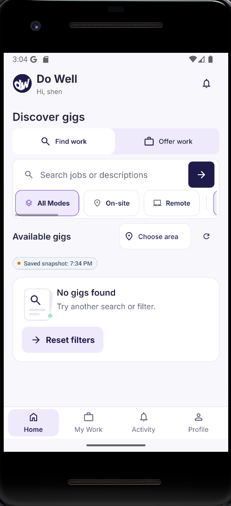 | 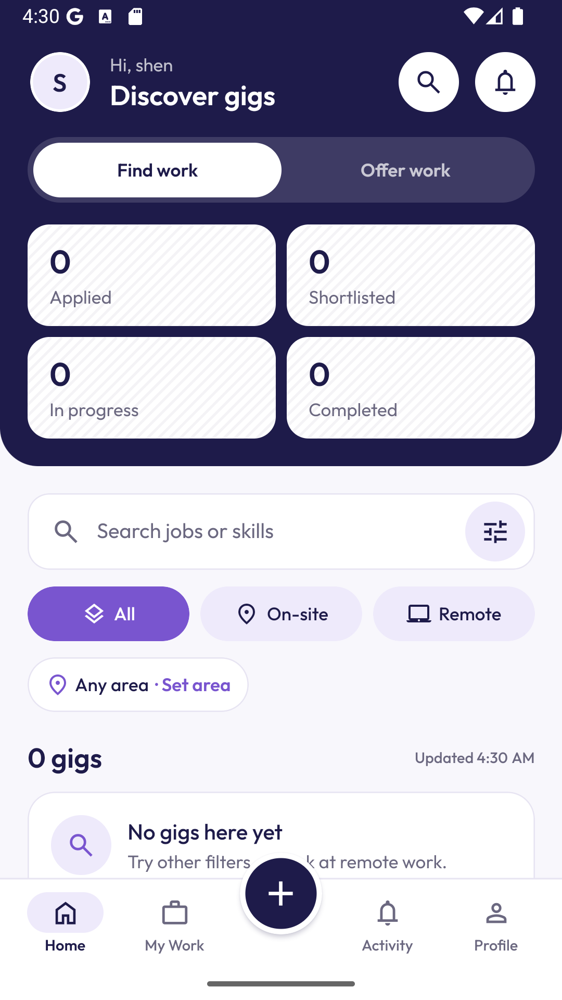 |
| My Work | 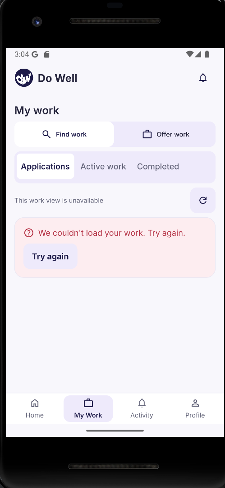 | 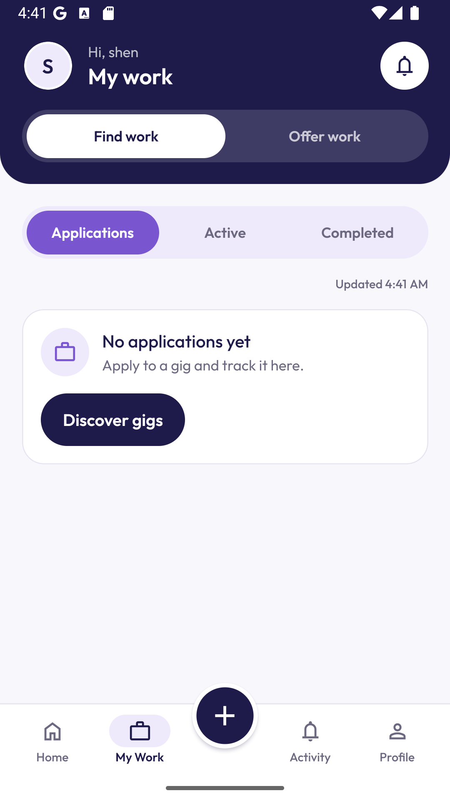 |
| Activity | 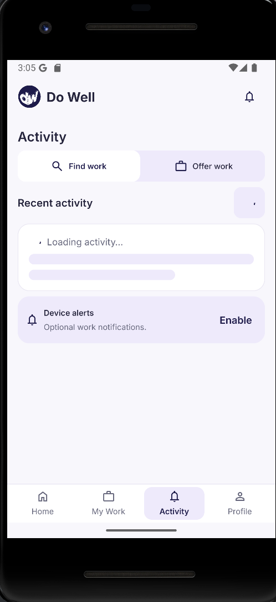 | 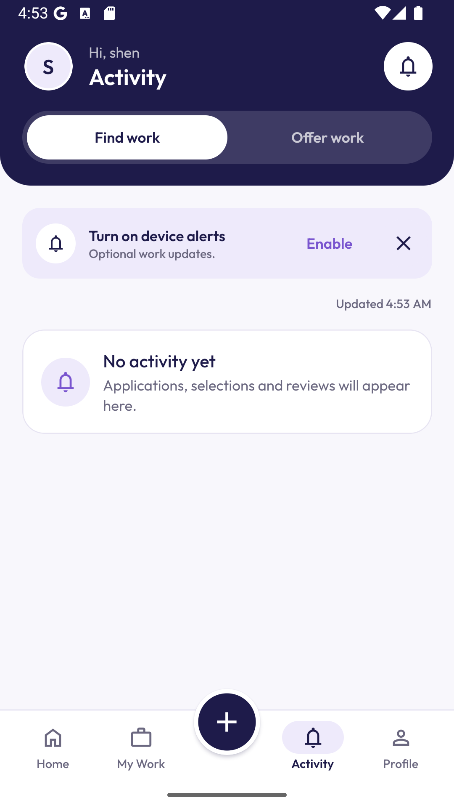 |
| Profile | 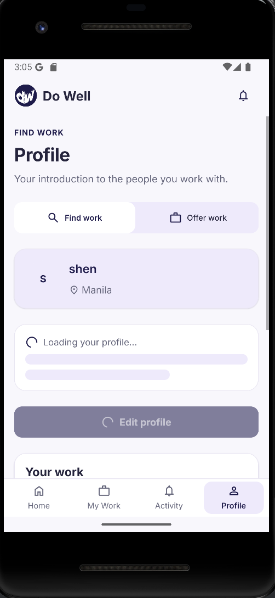 | 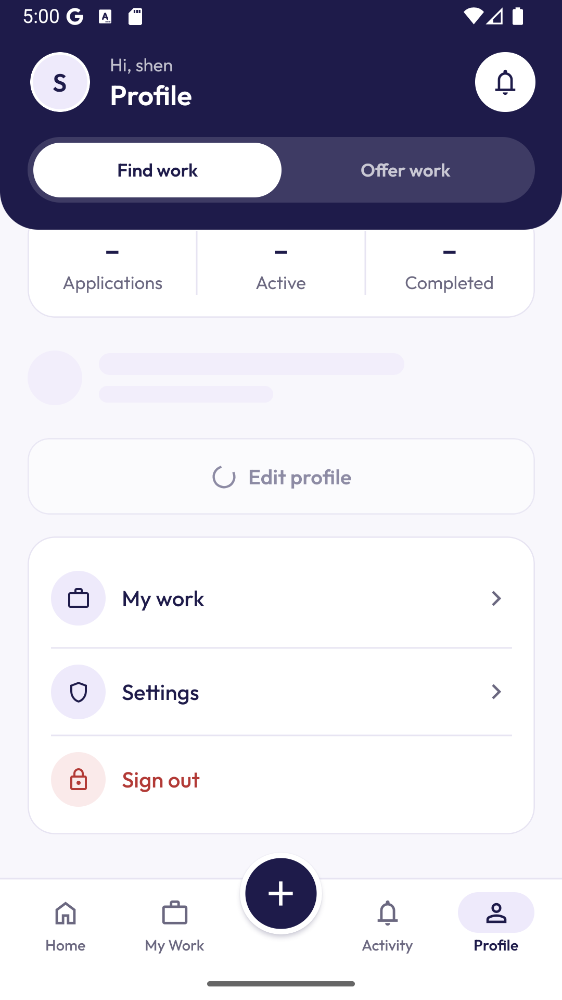 |

More after-states:

| Home (Offer work) | Filter sheet | Center-button sheet (Find work) | My Work (Offer) donut check* |
|---|---|---|---|
| 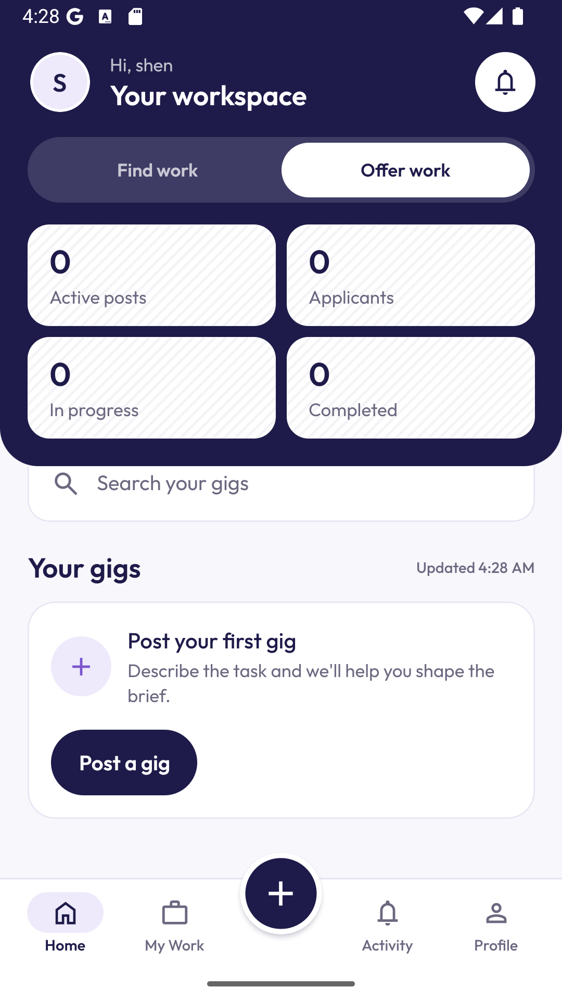 | 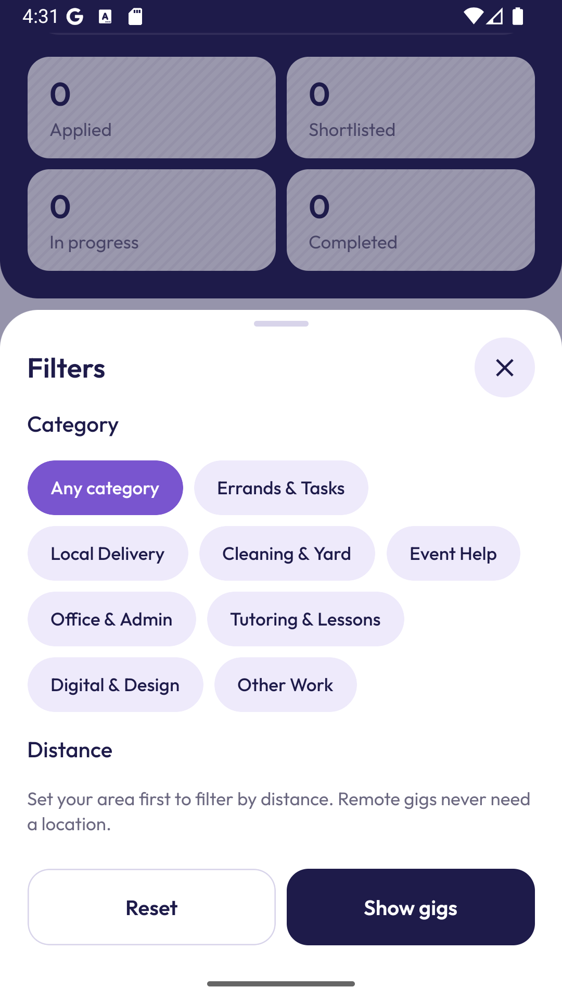 | 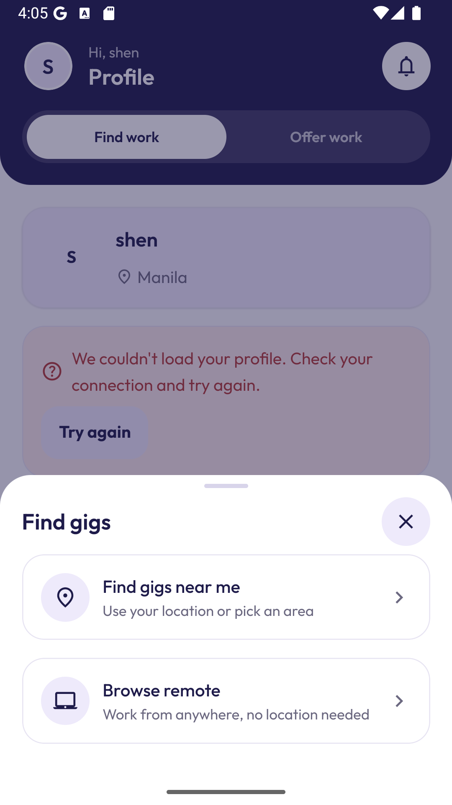 | 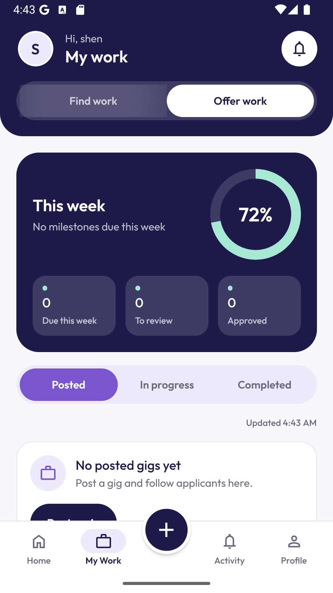 |

\*This screenshot was rendered with a **temporary** 72% value to confirm the no-SVG donut draws correctly. The change was reverted, and the committed file was confirmed byte-identical to the pre-check copy. With this account's real data the donut shows 0%.

The two inspiration images the owner supplied are third-party designs. They are not committed; this report only describes how their structure was applied.

## 3. What changed, by area

### 3.1 Palette and typography (`0c99972`)

- `src/shared/ui/theme.ts` is now the **single source of truth** (`brand`). The `@/theme` tokens derive from it, and all green tokens were removed.

| Role | Color | Used for |
|---|---|---|
| Primary | Navy `#1E1B4A` | Hero header, primary buttons, FAB, active tab, headings |
| Secondary | Purple `#7955CF` | Selected chips and segments, links, focus rings, progress fill on light surfaces |
| Tint | Lavender `#EEEAFB` | Only subtle tints: unselected chips, icon circles, tab pill |
| Background / surface / border | `#F8F7FC` / `#FFFFFF` / `#E7E4F2` | Page, cards, card borders |
| Accent | Mint `#A7E8D4` | Donut ring and highlights on navy, success, unread dots |
| Text | `#1E1B4A` / `#6B6880` / `#A09DB3` | Primary / secondary / decorative-only text |

- **Contrast (WCAG AA):**
  - Secondary text on white is 5.36:1.
  - White on purple is 5.23:1.
  - Purple *text* on lavender is only 4.43:1, so selected chips always use a purple fill with white text.
  - Each status color has a darkened text variant that passes on its tint (5.1–6.6:1).
- **Font:** Outfit Regular/Medium/SemiBold/Bold is bundled locally (224 KB, SIL OFL 1.1; licence in `branding/licenses/Outfit-OFL.txt`). The native splash stays up until fonts load, and the app falls back to the system font if loading fails.

### 3.2 Global shell (`0c99972`)

- **One navy hero header** on every screen: avatar (opens Profile), "Hi, {first name}", screen name, and white round icon buttons. The search button only appears where search exists. The bell's red dot appears only when there is real unread activity, from the RLS-scoped `list_user_activity` read cached for 60 s.
- **Find work / Offer work is one pill switch** (white on navy) inside the header. It is exposed to screen readers as a radio group. The full-width toggles, "FIND WORK" eyebrows and subtitles were removed from every screen.
- **Tab bar:** Home · My Work · raised navy + button · Activity · Profile.
  - In Offer work, the + button opens "Post a gig".
  - In Find work, it opens a sheet with "Find gigs near me" and "Browse remote". These reach Home as `?intent=near|remote&at=…`, and each tap is applied once.
- On Home, the hero scrolls away with the list. A navy strip stays behind the status bar so the white status icons remain readable.

### 3.3 Home (`65f959b`)

- **2 × 2 stat tiles inside the hero**, all from existing reads:

| Mode | Tiles | Source |
|---|---|---|
| Find work | Applied · Shortlisted · In progress · Completed | `work-gateway` lists. Applied = pending applications. **Shortlisted is a true 0**: the backend has no shortlist status |
| Offer work | Active posts · Applicants · In progress · Completed | Published gigs. Applicants = pending entries from `list_gig_applicants` across up to 10 published gigs ("N+" beyond 10) |

  Tiles show "–" while loading and "20+" when a list fills its 20-row page. Tapping a tile opens the matching My Work section.
- **Search bar with the filter icon inside it.** The arrow button is gone; the keyboard's search key submits. The filter sheet offers category and distance; distance is disabled with an explanation until an area is set.
- **All / On-site / Remote pills** split the width evenly, with no scrollbar or clipping.
- **Area chip:** "Any area · Set area" or "Makati · Change". A selected category shows as a removable chip.
- **Heading:** "N gigs", plus "near you" only once an area is set. A small "Updated 4:30 AM" caption sits beside it and turns orange ("Saved … · offline") for cached results.
- **Refresh:** pull-to-refresh replaces the refresh button.
- **Gig cards:** ₱ pay, approximate distance and area or a Remote badge, due date, and "Why this fits" using the existing server match reasons.
- **Compact empty states:** "No gigs here yet" (Reset filters / Browse remote) and "Post your first gig".

### 3.4 My Work (`4b510cd`)

- **Purple segmented sections:** Applications / Active / Completed (Find work) or Posted / In progress / Completed (Offer work). `?section=` deep links from the Home tiles.
- **Removed:** the "0 applications loaded" counter and the refresh button. Pull-to-refresh and an "Updated" caption replace them.
- **Task cards:**
  - Status badge, plus orange Due soon or red Overdue.
  - Progress bar from `listMilestones`: approved out of non-cancelled milestones, with completed work at 100%. If progress is unknown, no bar is shown.
  - The counterpart's avatar from `getAssignmentDetail`.
  - Progress and avatar load only for visible cards and are cached for 60 s.
- **Offer work "This week" navy card** with a mint donut: milestones due Monday–Sunday across in-progress jobs, with Due this week / To review / Approved.
- **Offline (approved hardening):**
  - `work-gateway` now throws a classified `LoadError`, with the same user-facing copy.
  - A user-scoped, zod-revalidated first-page snapshot is shown, labelled "Saved … · offline", **only** for offline or timeout failures, never for permission or login errors.

### 3.5 Activity (`530d96f`)

- **Grouped into Today and Earlier**, in white cards. Each event has a status-tinted icon circle (green for selected or completed, red for revision or cancelled, orange for submitted, purple otherwise). Unread events have a bold title and a mint dot with a dark ring, because mint alone is about 1.5:1 on white.
- **Slim "Turn on device alerts · Optional work updates" banner** at the top, with Enable and ✕. It shows only while alerts are off. Dismissal lasts for the app session and is not persisted.
- **Refresh:** pull-to-refresh with an "Updated" caption. The "Recent activity" heading and refresh button were removed.
- **Unchanged:** notification permission, channel and dedupe logic. Marking an event read refreshes the header bell dot.

### 3.6 Profile (`530d96f`)

- Large centered avatar (initial), name and area.
- **Stats row:** Applications / Active / Completed, or Posted / In progress / Completed in Offer work. Real reads, with "20+" at the page cap.
- About (bio), when present.
- **Outlined** Edit profile button, disabled only while the profile is loading.
- Settings list: My work, Settings, Sign out (red).
- **Bug fixed on device:** the error card's "Try again" opened the edit form and left the stats stale. It now reloads the profile and the counts in place. A regression test was added.

## 4. Honest-data rules applied

| Requested element | Decision | Reason |
|---|---|---|
| "Shortlisted" tile | Shows a real 0, not tappable | No shortlist status exists in the backend |
| ₱ range / schedule / skills filters | Not shown | The discovery query doesn't support them; `TODO(data)` |
| Skills chips, rating, availability on Profile | Not shown | No profile columns; `TODO(data)` |
| Avatar photos | Initials only | No avatar upload flow exists |
| "AI" labels (component built for the later builder step) | "Suggested by AI" only when the draft really came from AI, otherwise "Template suggestion" | `tests/security/truth-in-advertising.test.ts` |
| Counts while loading or after a failed read | "–" | Never show a misleading zero |

## 5. Technical notes for reviewers

- **Animations use React Native's built-in `Animated`** (native driver), not Reanimated. Reanimated 4.7 cannot load under this repo's Jest setup, even with its official mocks. Reduce-motion is respected through `AccessibilityInfo`.
- **The donut is drawn without `react-native-svg`** (plan decision D3): two clipped half-rings rotated into view. This avoids a native rebuild, which has been blocked on Windows by CMake path-length failures.
- **Shared components land in the first commit at their final state.** Later steps also extended them (compact `EmptyState`/`ErrorState`, compact buttons, new tokens), but the first commit carries the final versions so every commit typechecks on its own. The Activity + Profile commit message mentions the compact `ErrorState`; its code is in `0c99972`.
- **Lazy gateway imports** in `useUnreadActivity`, `home-stats` and `work-insights` keep the Supabase client and AsyncStorage out of module scope, so screens stay testable without native modules.
- **Test infrastructure:** `jest.config.js` adds `tests/setup/jest.setup.js` with the official safe-area mock. The route test now keeps the auth module's real exports and mocks only `useAuth`.
- **Temporary compatibility:** the legacy `setupTheme` object still exists. Its values now come from `brand`, and unmigrated screens (task workspace, gig details, gig form, auth) still read it.

## 6. Verification

- **Each commit was typechecked on its own**, with the uncommitted remainder stashed. The final commit also passed the full test suite.
- **Final state:** Prettier clean, ESLint 0 errors/warnings, `tsc --noEmit` clean, **110 suites / 690 tests passed** (up from 103 / 628 at `6177b64`).
- **Checked on the emulator:** every tab in both modes, Home scrolling, the filter sheet, the center-button sheet, the mode-switch animation, the weekly donut (temporary 72% render), dismissing the Activity banner, and Profile retry recovery.
- **Secret scan** over all committed changes found no keys, tokens or service-role values.

## 7. Known limits and open items

- **Not verified live with real data:** task cards with progress and avatars, non-empty Activity groups, and gig cards. The test account has no gigs, applications or assignments. Unit tests cover these states.
- **The emulator's DNS was intermittent** during this session: lookups failed at about 03:04 and 04:55 and recovered afterwards. This is an environment issue, not an app issue. Screens showed honest error and offline states, and recovered on retry.
- **Not yet redesigned** (they inherit the new palette only): the task workspace (assignment detail), gig details and applicants, the Post a gig / AI Job Brief Builder, and auth/onboarding.
- **Cleanup still to do:** removing the `setupTheme` bridge, the remaining hard-coded colors (`OfflineBanner`, `StaleDataBadge`, `AiJobBriefModal`) and the unused Inter font files.
- **Not checked:** TalkBack, font scale 1.3× on 360 dp, and the docked keyboard.
- **Session-only state:** the alerts-banner dismissal is not persisted.
